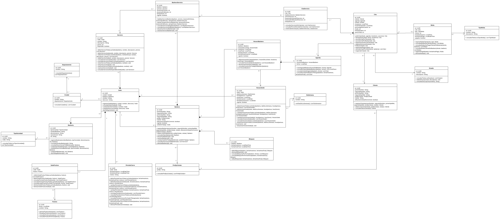

# Documentación del diagrama de clases — Sistema de agendamiento de citas de barbería

Documentación de las clases del sistema de agendamiento de citas para barberías con varias sedes. 

## Contenido

1. [Diagrama de clases](#diagrama-de-clases)
2. [Convenciones](#convenciones)
3. [Índice de clases](#índice-de-clases)
4. [Relaciones entre clases](#relaciones-entre-clases)
5. [Detalle de cada clase](#detalle-de-cada-clase)
   - **Catálogos:** [DiaSemana](#diasemana), [Departamento](#departamento), [Estado](#estado), [PrefijoCelular](#prefijocelular), [TipoMulta](#tipomulta), [Festivo](#festivo), [TipoSociedad](#tiposociedad)
   - **Barbería y ubicación:** [Barberia](#barberia), [Ciudad](#ciudad), [Sede](#sede), [Servicio](#servicio), [HorarioSede](#horariosede), [PeriodoCierre](#periodocierre), [SedeFestivo](#sedefestivo)
   - **Personas:** [Cliente](#cliente), [Barbero](#barbero), [BarberoServicio](#barberoservicio)
   - **Horarios y agenda:** [HorarioBarbero](#horariobarbero), [Bloqueo](#bloqueo), [Agenda](#agenda)
   - **Citas y multas:** [Cita](#cita), [CitaServicio](#citaservicio), [Multa](#multa)

## Diagrama de clases

## Convenciones

- **Visibilidad:** `-` privado (todos los atributos) y `+` público (constructores y métodos).
- **Constructores:** cada clase tiene un constructor **por defecto**, que deja todos los atributos en su valor por defecto, y uno **parametrizado**, que recibe un valor (`valorAtributo`) por cada atributo.
- **Métodos accesores:** cada atributo tiene un *getter* (`getAtributo()`) y un *setter* (`setAtributo(valorAtributo): void`).
- **Valores por defecto:** ningún atributo queda en `null`. Textos en `""`, números en `0`, UUID en `new UUID(0L, 0L)`, fechas en `LocalDate.of(1000, 1, 1)`, horas en `LocalTime.of(0, 0)` y referencias a otras clases en un objeto vacío (por ejemplo, `new Sede()`).
- **Paso de parámetros:** los tipos primitivos y `String` se pasan *por valor*; los objetos (`UUID`, fechas y clases del dominio) *por referencia*.
- **Relaciones:** *Necesita de* indica que la clase tiene un atributo del tipo de la otra clase; *Es usada por* indica que otra clase la tiene como atributo. Las multiplicidades se leen como «multiplicidad de esta clase → multiplicidad de la otra».
- **Tipos de relación:** *Composición* cuando la parte no existe sin el todo (por ejemplo, un `Servicio` no existe sin su `Sede`); *Agregación* cuando la parte puede cambiar de dueño (`Barbero` y su `Sede`); *Asociación* para el resto, principalmente las referencias a catálogos.

## Índice de clases

### Catálogos

Datos de referencia que el sistema consulta y que no cambian con la operación diaria.

| Clase | Descripción |
|---|---|
| [DiaSemana](#diasemana) | Representa cada uno de los días de la semana que se usa como catálogo para definir los horarios de la barbería y de cada barbero. |
| [Departamento](#departamento) | Representa cada uno de los departamentos del país en los que se encuentran las ciudades donde la barbería puede tener sedes. |
| [Estado](#estado) | Representa en qué situación puntual se encuentra una cita: agendada, finalizada, cancelada por alguna de las partes, por cambio de políticas de la barbería o por veto, con demora del cliente o del barbero, con inasistencia del cliente o sin pago. |
| [PrefijoCelular](#prefijocelular) | Representa el catálogo de prefijos telefónicos, que los van a usar los clientes y barberos. |
| [TipoMulta](#tipomulta) | Representa los tipos de multa que puede recibir un cliente: por tardanza, por inasistencia o por no pagar los servicios recibidos. |
| [Festivo](#festivo) | Representa cada fecha festiva de Colombia en la que, por ley, es día de descanso. El sistema genera automáticamente los festivos de cada año a partir del calendario oficial de festivos, con la fecha en la que realmente se descansa (ya trasladada al lunes cuando la ley lo indica). Por defecto ninguna sede abre en un festivo. |
| [TipoSociedad](#tiposociedad) | Representa el catálogo de tipos de sociedad con los que puede estar constituida legalmente una barbería ante la Cámara de Comercio (S.A.S., Ltda. o S.A.), cada uno con el sufijo que se agrega al final de su razón social. |

### Barbería y ubicación

La barbería, sus sedes, dónde están ubicadas y lo que cada sede define (servicios, horarios, cierres y festivos).

| Clase | Descripción |
|---|---|
| [Barberia](#barberia) | Representa la cadena o marca comercial de barbería, dueña de una o varias sedes. |
| [Ciudad](#ciudad) | Representa cada una de las ciudades, pertenecientes a un departamento, en las que puede estar ubicada una sede de la barbería. |
| [Sede](#sede) | Representa cada una de las sucursales físicas de una barbería, ubicada en una ciudad puntual, donde se ofrecen los servicios y trabajan los barberos. |
| [Servicio](#servicio) | Representa cada tipo de corte o arreglo que ofrece una sede de la barbería; el administrador puede definirlo para todas las sedes a la vez o para una sede en particular, y cada barbero decide cuáles sabe hacer. |
| [HorarioSede](#horariosede) | Representa los horarios de apertura y cierre de una sede de la barbería para cada día de la semana; una sede puede tener varios horarios el mismo día (jornada partida) si no se cruzan. El administrador puede definirlos para todas las sedes a la vez o para una sede en particular, y son el límite dentro del cual debe caber el horario de cualquier barbero de esa sede. |
| [PeriodoCierre](#periodocierre) | Representa un intervalo de fecha y hora durante el cual una sede de la barbería permanece cerrada por una decisión de la barbería (por ejemplo vacaciones, mantenimiento o remodelación): mientras dura no se atiende a clientes ni se pueden agendar citas que se crucen con él. El administrador puede registrarlo para todas las sedes de la barbería a la vez o para una sede en particular. |
| [SedeFestivo](#sedefestivo) | Representa la decisión de una sede de abrir en un festivo puntual. Por defecto ninguna sede abre en los festivos; si la sede tiene registrado el festivo, ese día atiende con su horario habitual del día de la semana en que cae. El administrador puede definirla para todas las sedes a la vez o para una sede en particular. |

### Personas

Clientes, barberos y los servicios que sabe hacer cada barbero.

| Clase | Descripción |
|---|---|
| [Cliente](#cliente) | Representa a la persona que solicita citas en las sedes de una o varias barberías. Si tiene multas sin pagar en una barbería, no puede agendar en ninguna de sus sedes, pero sí en las demás barberías. |
| [Barbero](#barbero) | Representa a un trabajador de la barbería que atiende clientes según los servicios que sabe realizar, organiza su propio horario y tiene su agenda personal para atender todas las citas que valla teniendo. |
| [BarberoServicio](#barberoservicio) | Representa qué servicios sabe hacer cada barbero, cuánto se demora en realizarlos y cuánto tiempo extra usa de colchón, ya que no todos los barberos ofrecen los mismos servicios que están en la barbería. |

### Horarios y agenda

Disponibilidad de cada barbero.

| Clase | Descripción |
|---|---|
| [HorarioBarbero](#horariobarbero) | Representa el día de la semana en que trabaja un barbero, junto con la hora en la que empieza y termina su jornada de trabajo. |
| [Bloqueo](#bloqueo) | Representa los momentos en que el barbero no esta disponible para atender sus citas, el barbero establece la hora y la fecha en que empieza y termina ese estado de no disponible. |
| [Agenda](#agenda) | Representa una fecha puntual en donde el barbero ve todas las citas que debe de atender ese día. El sistema la crea con anticipación, de modo que siempre haya agendas desde hoy hasta 15 días después. |

### Citas y multas

La reserva, los servicios que incluye y las sanciones al cliente.

| Clase | Descripción |
|---|---|
| [Cita](#cita) | Representa la reserva de un cliente con un barbero para un fecha y hora puntual, con los servicios pedidos, su estado, y lo que realmente ocurrió (atención, tardanzas, inasistencia). |
| [CitaServicio](#citaservicio) | Representa cada servicio incluido dentro de una cita puntual, guardando el precio y la duración que tenía ese servicio para ese barbero en el momento exacto en que se agendó, para que cambios futuros en el catálogo no alteren citas ya registradas. |
| [Multa](#multa) | Representa la sanción económica que se le impone a un cliente por incumplir una cita, ya sea por llegar tarde fuera de tolerancia, por no presentarse o por no pagar los servicios recibidos, calculada a partir de la cita específica que la originó. Mientras siga sin pagar, el cliente queda vetado en la barbería donde se originó. |

## Relaciones entre clases

Cada fila se lee: *la clase de origen tiene un atributo del tipo de la clase de destino*.

| Clase origen | Multiplicidad origen | Tipo de relación | Multiplicidad destino | Clase destino |
|---|:---:|---|:---:|---|
| [Barberia](#barberia) | 0..* | Asociación | 1 | [TipoSociedad](#tiposociedad) |
| [Ciudad](#ciudad) | 1..* | Asociación | 1 | [Departamento](#departamento) |
| [Sede](#sede) | 0..* | Asociación | 1 | [Ciudad](#ciudad) |
| [Sede](#sede) | 0..* | Composición | 1 | [Barberia](#barberia) |
| [Servicio](#servicio) | 0..* | Composición | 1 | [Sede](#sede) |
| [HorarioSede](#horariosede) | 0..* | Composición | 1 | [Sede](#sede) |
| [HorarioSede](#horariosede) | 0..* | Asociación | 1 | [DiaSemana](#diasemana) |
| [PeriodoCierre](#periodocierre) | 0..* | Composición | 1 | [Sede](#sede) |
| [SedeFestivo](#sedefestivo) | 0..* | Composición | 1 | [Sede](#sede) |
| [SedeFestivo](#sedefestivo) | 0..* | Asociación | 1 | [Festivo](#festivo) |
| [Cliente](#cliente) | 0..* | Asociación | 1 | [PrefijoCelular](#prefijocelular) |
| [Barbero](#barbero) | 0..* | Asociación | 1 | [PrefijoCelular](#prefijocelular) |
| [Barbero](#barbero) | 0..* | Agregación | 1 | [Sede](#sede) |
| [BarberoServicio](#barberoservicio) | 0..* | Composición | 1 | [Barbero](#barbero) |
| [BarberoServicio](#barberoservicio) | 0..* | Asociación | 1 | [Servicio](#servicio) |
| [HorarioBarbero](#horariobarbero) | 0..* | Composición | 1 | [Barbero](#barbero) |
| [HorarioBarbero](#horariobarbero) | 0..* | Asociación | 1 | [HorarioSede](#horariosede) |
| [Bloqueo](#bloqueo) | 0..* | Composición | 1 | [Barbero](#barbero) |
| [Agenda](#agenda) | 0..* | Composición | 1 | [HorarioBarbero](#horariobarbero) |
| [Cita](#cita) | 0..* | Asociación | 1 | [Cliente](#cliente) |
| [Cita](#cita) | 0..* | Asociación | 1 | [Agenda](#agenda) |
| [Cita](#cita) | 0..* | Asociación | 1 | [Estado](#estado) |
| [CitaServicio](#citaservicio) | 1..* | Composición | 1 | [Cita](#cita) |
| [CitaServicio](#citaservicio) | 0..* | Asociación | 1 | [BarberoServicio](#barberoservicio) |
| [Multa](#multa) | 0..1 | Asociación | 1 | [Cita](#cita) |
| [Multa](#multa) | 0..* | Asociación | 1 | [TipoMulta](#tipomulta) |

## Detalle de cada clase

---

## Catálogos

### DiaSemana

Representa cada uno de los días de la semana que se usa como catálogo para definir los horarios de la barbería y de cada barbero.

#### Relaciones

| Relación | Tipo | Clase relacionada | Multiplicidad de esta clase | Multiplicidad de la otra |
|---|---|---|:---:|:---:|
| Es usada por | Asociación | [HorarioSede](#horariosede) | 1 | 0..* |

#### Atributos

| Atributo | Tipo | Valor por defecto | Descripción |
|---|---|---|---|
| `id` | `UUID` | `new UUID(0L, 0L)` | Representa un identificador que hará unico cada objeto de dominio de este tipo, no se puede repetir |
| `nombre` | `String` | `""` | Representa como se llama el dia de la semana, para los horarios |

#### Constructores

- **Defecto** — `DiaSemana()`  
  Constructor por defecto que crea un objeto DiaSemana con todos sus atributos en su valor por defecto
- **Parametrizado** — `DiaSemana(valorId: UUID, valorNombre: String)`  
  Constructor parametrizado que crea un objeto DiaSemana asignando el valor recibido a cada uno de sus atributos

<strong>Métodos accesores</strong> (4)

| Atributo | Getter | Setter |
|---|---|---|
| `id` | `getId(): UUID` | `setId(valorId: UUID): void` |
| `nombre` | `getNombre(): String` | `setNombre(valorNombre: String): void` |

#### Métodos

| Método | Retorna | Descripción |
|---|---|---|
| [`verDiasDeLaSemana()`](#diasemana-verdiasdelasemana) | `List<DiaSemana>` | Permite consultar el catálogo de días de la semana para definir los horarios |

**`verDiasDeLaSemana`**

*Sin parámetros.*

**Retorna:** `List<DiaSemana>`

[↑ Volver al índice](#índice-de-clases)

### Departamento

Representa cada uno de los departamentos del país en los que se encuentran las ciudades donde la barbería puede tener sedes.

#### Relaciones

| Relación | Tipo | Clase relacionada | Multiplicidad de esta clase | Multiplicidad de la otra |
|---|---|---|:---:|:---:|
| Es usada por | Asociación | [Ciudad](#ciudad) | 1 | 1..* |

#### Atributos

| Atributo | Tipo | Valor por defecto | Descripción |
|---|---|---|---|
| `id` | `UUID` | `new UUID(0L, 0L)` | Representa un identificador que hará unico cada objeto de dominio de este tipo, no se puede repetir |
| `nombre` | `String` | `""` | Representa el nombre del departamento en el que están ubicadas las ciudades donde la barbería puede tener sedes |

#### Constructores

- **Defecto** — `Departamento()`  
  Constructor por defecto que crea un objeto Departamento con todos sus atributos en su valor por defecto
- **Parametrizado** — `Departamento(valorId: UUID, valorNombre: String)`  
  Constructor parametrizado que crea un objeto Departamento asignando el valor recibido a cada uno de sus atributos

<strong>Métodos accesores</strong> (4)

| Atributo | Getter | Setter |
|---|---|---|
| `id` | `getId(): UUID` | `setId(valorId: UUID): void` |
| `nombre` | `getNombre(): String` | `setNombre(valorNombre: String): void` |

#### Métodos

| Método | Retorna | Descripción |
|---|---|---|
| [`consultarDepartamentos()`](#departamento-consultardepartamentos) | `List<Departamento>` | Permite consultar el catálogo de departamentos disponibles |

**`consultarDepartamentos`**

*Sin parámetros.*

**Retorna:** `List<Departamento>`

[↑ Volver al índice](#índice-de-clases)

### Estado

Representa en qué situación puntual se encuentra una cita: agendada, finalizada, cancelada por alguna de las partes, por cambio de políticas de la barbería o por veto, con demora del cliente o del barbero, con inasistencia del cliente o sin pago.

#### Relaciones

| Relación | Tipo | Clase relacionada | Multiplicidad de esta clase | Multiplicidad de la otra |
|---|---|---|:---:|:---:|
| Es usada por | Asociación | [Cita](#cita) | 1 | 0..* |

#### Atributos

| Atributo | Tipo | Valor por defecto | Descripción |
|---|---|---|---|
| `id` | `UUID` | `new UUID(0L, 0L)` | Representa un identificador que hará unico cada objeto de dominio de este tipo, no se puede repetir |
| `nombre` | `String` | `""` | Representa como se llama el estado en el que se encuentra una cita puntual |
| `descripcion` | `String` | `""` | Representa el significado de que representa cada estado para la cita |

#### Constructores

- **Defecto** — `Estado()`  
  Constructor por defecto que crea un objeto Estado con todos sus atributos en su valor por defecto
- **Parametrizado** — `Estado(valorId: UUID, valorNombre: String, valorDescripcion: String)`  
  Constructor parametrizado que crea un objeto Estado asignando el valor recibido a cada uno de sus atributos

<strong>Métodos accesores</strong> (6)

| Atributo | Getter | Setter |
|---|---|---|
| `id` | `getId(): UUID` | `setId(valorId: UUID): void` |
| `nombre` | `getNombre(): String` | `setNombre(valorNombre: String): void` |
| `descripcion` | `getDescripcion(): String` | `setDescripcion(valorDescripcion: String): void` |

#### Métodos

| Método | Retorna | Descripción |
|---|---|---|
| [`consultarTodosLosEstados()`](#estado-consultartodoslosestados) | `List<Estado>` | Permite consultar los estados posibles que puede tener una cita |
| [`editarDescripcion(id, descripcion)`](#estado-editardescripcion) | `void` | Permite ajustar el texto descriptivo de un estado ya creado, sin cambiar su significado en el flujo de la cita |
| [`consultarDescripcion(nombre)`](#estado-consultardescripcion) | `String` | Permite consultar la descripcion de un estado en especifico |

**`consultarTodosLosEstados`**

*Sin parámetros.*

**Retorna:** `List<Estado>`

**`editarDescripcion`**

| Parámetro | Tipo | Descripción |
|---|---|---|
| `id` | `UUID` | Corresponde al identificador del estado que se va a editar |
| `descripcion` | `String` | Representa el significado de que representa cada estado para la cita |

**Retorna:** `void`

**Excepciones:**

- Informar con un mensaje que no existe un estado con el identificador enviado y por lo tanto no es posible modificar la descripción
- Generar una excepción indicándole al usuario cuáles datos de la descripción del estado no cumplen con las reglas definidas

**`consultarDescripcion`**

| Parámetro | Tipo | Descripción |
|---|---|---|
| `nombre` | `String` | Representa como se llama el estado en el que se encuentra una cita puntual |

**Retorna:** `String`

**Excepciones:**

- Informar con un mensaje que no existe un Estado con el identificador enviado y por lo tanto no es posible modificar la descripción

[↑ Volver al índice](#índice-de-clases)

### PrefijoCelular

Representa el catálogo de prefijos telefónicos, que los van a usar los clientes y barberos.

#### Relaciones

| Relación | Tipo | Clase relacionada | Multiplicidad de esta clase | Multiplicidad de la otra |
|---|---|---|:---:|:---:|
| Es usada por | Asociación | [Cliente](#cliente) | 1 | 0..* |
| Es usada por | Asociación | [Barbero](#barbero) | 1 | 0..* |

#### Atributos

| Atributo | Tipo | Valor por defecto | Descripción |
|---|---|---|---|
| `id` | `UUID` | `new UUID(0L, 0L)` | Representa un identificador que hará unico cada objeto de dominio de este tipo, no se puede repetir |
| `prefijo` | `String` | `"+0"` | Representa el prefijo telefónico del país que el administrador habilita para que la barbería pueda atender números de ese país |

#### Constructores

- **Defecto** — `PrefijoCelular()`  
  Constructor por defecto que crea un objeto PrefijoCelular con todos sus atributos en su valor por defecto
- **Parametrizado** — `PrefijoCelular(valorId: UUID, valorPrefijo: String)`  
  Constructor parametrizado que crea un objeto PrefijoCelular asignando el valor recibido a cada uno de sus atributos

<strong>Métodos accesores</strong> (4)

| Atributo | Getter | Setter |
|---|---|---|
| `id` | `getId(): UUID` | `setId(valorId: UUID): void` |
| `prefijo` | `getPrefijo(): String` | `setPrefijo(valorPrefijo: String): void` |

#### Métodos

| Método | Retorna | Descripción |
|---|---|---|
| [`consultarPrefijosCelular()`](#prefijocelular-consultarprefijoscelular) | `List<PrefijoCelular>` | Permite al barbero y al cliente consultar el catálogo de prefijos telefónicos de país disponibles |

**`consultarPrefijosCelular`**

*Sin parámetros.*

**Retorna:** `List<PrefijoCelular>`

[↑ Volver al índice](#índice-de-clases)

### TipoMulta

Representa los tipos de multa que puede recibir un cliente: por tardanza, por inasistencia o por no pagar los servicios recibidos.

#### Relaciones

| Relación | Tipo | Clase relacionada | Multiplicidad de esta clase | Multiplicidad de la otra |
|---|---|---|:---:|:---:|
| Es usada por | Asociación | [Multa](#multa) | 1 | 0..* |

#### Atributos

| Atributo | Tipo | Valor por defecto | Descripción |
|---|---|---|---|
| `id` | `UUID` | `new UUID(0L, 0L)` | Representa un identificador que hará unico cada objeto de dominio de este tipo, no se puede repetir |
| `nombre` | `String` | `""` | Representa el nombre del tipo de multa |
| `descripcion` | `String` | `""` | Representa que hace cada tipo de multa |

#### Constructores

- **Defecto** — `TipoMulta()`  
  Constructor por defecto que crea un objeto TipoMulta con todos sus atributos en su valor por defecto
- **Parametrizado** — `TipoMulta(valorId: UUID, valorNombre: String, valorDescripcion: String)`  
  Constructor parametrizado que crea un objeto TipoMulta asignando el valor recibido a cada uno de sus atributos

<strong>Métodos accesores</strong> (6)

| Atributo | Getter | Setter |
|---|---|---|
| `id` | `getId(): UUID` | `setId(valorId: UUID): void` |
| `nombre` | `getNombre(): String` | `setNombre(valorNombre: String): void` |
| `descripcion` | `getDescripcion(): String` | `setDescripcion(valorDescripcion: String): void` |

#### Métodos

| Método | Retorna | Descripción |
|---|---|---|
| [`consultarTodosLosTiposMulta()`](#tipomulta-consultartodoslostiposmulta) | `List<TipoMulta>` | Permite consultar los tipos de multa que puede recibir un cliente |

**`consultarTodosLosTiposMulta`**

*Sin parámetros.*

**Retorna:** `List<TipoMulta>`

[↑ Volver al índice](#índice-de-clases)

### Festivo

Representa cada fecha festiva de Colombia en la que, por ley, es día de descanso. El sistema genera automáticamente los festivos de cada año a partir del calendario oficial de festivos, con la fecha en la que realmente se descansa (ya trasladada al lunes cuando la ley lo indica). Por defecto ninguna sede abre en un festivo.

#### Relaciones

| Relación | Tipo | Clase relacionada | Multiplicidad de esta clase | Multiplicidad de la otra |
|---|---|---|:---:|:---:|
| Es usada por | Asociación | [SedeFestivo](#sedefestivo) | 1 | 0..* |

#### Atributos

| Atributo | Tipo | Valor por defecto | Descripción |
|---|---|---|---|
| `id` | `UUID` | `new UUID(0L, 0L)` | Representa un identificador que hará unico cada objeto de dominio de este tipo, no se puede repetir |
| `fecha` | `LocalDate` | `LocalDate.of(1000, 1, 1)` | Representan las fechas que son festivos en Colombia |
| `nombre` | `String` | `""` | Representa el nombre con el que se conoce el festivo (por ejemplo Día de la Raza o Independencia de Cartagena); lo genera el sistema y se le muestra al administrador, al barbero y al cliente |

#### Constructores

- **Defecto** — `Festivo()`  
  Constructor por defecto que crea un objeto Festivo con todos sus atributos en su valor por defecto
- **Parametrizado** — `Festivo(valorId: UUID, valorFecha: LocalDate, valorNombre: String)`  
  Constructor parametrizado que crea un objeto Festivo asignando el valor recibido a cada uno de sus atributos

<strong>Métodos accesores</strong> (6)

| Atributo | Getter | Setter |
|---|---|---|
| `id` | `getId(): UUID` | `setId(valorId: UUID): void` |
| `fecha` | `getFecha(): LocalDate` | `setFecha(valorFecha: LocalDate): void` |
| `nombre` | `getNombre(): String` | `setNombre(valorNombre: String): void` |

#### Métodos

| Método | Retorna | Descripción |
|---|---|---|
| [`generarFestivosAnio(anio)`](#festivo-generarfestivosanio) | `List<Festivo>` | Comando que permite al sistema registrar automáticamente todos los festivos de Colombia de un año, con su fecha y su nombre, tomándolos del calendario oficial de festivos que provee la librería Jollyday. Se ejecuta cada 1 de diciembre para el año siguiente, para que los festivos existan antes de que se puedan agendar citas en ese año |
| [`actualizarFestivosAnio(anio)`](#festivo-actualizarfestivosanio) | `List<Festivo>` | Comando que permite al sistema volver a comparar los festivos registrados de un año con el calendario oficial de festivos cuando cambia la ley (por ejemplo cuando se crea un festivo nuevo o se elimina uno): registra los que falten, elimina los que ya no son festivo y corrige el nombre de los que cambiaron. Se ejecuta cuando se actualiza el calendario oficial de festivos del sistema y solo afecta los festivos que todavía no han llegado |
| [`consultarFestivosAnio(anio)`](#festivo-consultarfestivosanio) | `List<Festivo>` | Permite consultar los festivos de Colombia de un año, con su fecha y su nombre, para que el administrador decida en cuáles abre cada sede y el barbero y el cliente sepan qué días no se atiende |
| [`consultarFestivoPorFecha(fecha)`](#festivo-consultarfestivoporfecha) | `Festivo` | Permite al sistema saber si una fecha es festivo en Colombia, para que luego determine si una sede abre ese día al abrir una agenda o al agendar una cita |

**`generarFestivosAnio`**

| Parámetro | Tipo | Descripción |
|---|---|---|
| `anio` | `int` | Corresponde al año de los festivos de Colombia sobre los que se hace la operación |

**Retorna:** `List<Festivo>`

**Excepciones:**

- Generar una excepción indicando que el año no cumple con las reglas definidas
- Generar una excepción indicando que solo se pueden generar los festivos del año actual o del año siguiente
- Informar con un mensaje que los festivos de ese año ya fueron generados y que, si cambió la ley, se deben actualizar
- Si no se puede consultar el calendario oficial de festivos, generar una excepción informando que no fue posible obtener los festivos del año
- Unir los nombres de los festivos que caen en la misma fecha y registrar uno solo
- Si alguno de los festivos no pudo ser registrado, revertir toda la operación e informar el error
- Generar un nuevo id para el Festivo y volver a validar que no lo tenga otro Festivo

**`actualizarFestivosAnio`**

| Parámetro | Tipo | Descripción |
|---|---|---|
| `anio` | `int` | Corresponde al año de los festivos de Colombia sobre los que se hace la operación |

**Retorna:** `List<Festivo>`

**Excepciones:**

- Generar una excepción indicando que el año no cumple con las reglas definidas
- Informar con un mensaje que el año no tiene festivos registrados y que primero se deben generar
- Si no se puede consultar el calendario oficial de festivos, generar una excepción informando que no fue posible obtener los festivos del año
- Unir los nombres de los festivos que caen en la misma fecha y registrar uno solo
- Dejar sin cambios los festivos de hoy y los pasados
- Si alguna de las citas no pudo ser cancelada, revertir toda la operación e informar el error
- Si alguna de las aperturas de festivo no pudo ser eliminada, revertir toda la operación e informar el error
- Si alguno de los festivos no pudo ser registrado, cambiado o eliminado, revertir toda la operación e informar el error
- Generar un nuevo id para el Festivo y volver a validar que no lo tenga otro Festivo

**`consultarFestivosAnio`**

| Parámetro | Tipo | Descripción |
|---|---|---|
| `anio` | `int` | Corresponde al año de los festivos de Colombia sobre los que se hace la operación |

**Retorna:** `List<Festivo>`

**`consultarFestivoPorFecha`**

| Parámetro | Tipo | Descripción |
|---|---|---|
| `fecha` | `LocalDate` | Representan las fechas que son festivos en Colombia |

**Retorna:** `Festivo`

[↑ Volver al índice](#índice-de-clases)

### TipoSociedad

Representa el catálogo de tipos de sociedad con los que puede estar constituida legalmente una barbería ante la Cámara de Comercio (S.A.S., Ltda. o S.A.), cada uno con el sufijo que se agrega al final de su razón social.

#### Relaciones

| Relación | Tipo | Clase relacionada | Multiplicidad de esta clase | Multiplicidad de la otra |
|---|---|---|:---:|:---:|
| Es usada por | Asociación | [Barberia](#barberia) | 1 | 0..* |

#### Atributos

| Atributo | Tipo | Valor por defecto | Descripción |
|---|---|---|---|
| `id` | `UUID` | `new UUID(0L, 0L)` | Representa un identificador que hará unico cada objeto de dominio de este tipo, no se puede repetir |
| `nombre` | `String` | `""` | Representa el nombre completo del tipo de sociedad |
| `sufijo` | `String` | `""` | Representa la abreviatura legal del tipo de sociedad que se agrega al final de la razón social |

#### Constructores

- **Defecto** — `TipoSociedad()`  
  Constructor por defecto que crea un objeto TipoSociedad con todos sus atributos en su valor por defecto
- **Parametrizado** — `TipoSociedad(valorId: UUID, valorNombre: String, valorSufijo: String)`  
  Constructor parametrizado que crea un objeto TipoSociedad asignando el valor recibido a cada uno de sus atributos

<strong>Métodos accesores</strong> (6)

| Atributo | Getter | Setter |
|---|---|---|
| `id` | `getId(): UUID` | `setId(valorId: UUID): void` |
| `nombre` | `getNombre(): String` | `setNombre(valorNombre: String): void` |
| `sufijo` | `getSufijo(): String` | `setSufijo(valorSufijo: String): void` |

#### Métodos

| Método | Retorna | Descripción |
|---|---|---|
| [`consultarTodosLosTiposSociedad()`](#tiposociedad-consultartodoslostipossociedad) | `List<TipoSociedad>` | Permite consultar los tipos de sociedad con los que puede estar constituida una barbería |

**`consultarTodosLosTiposSociedad`**

*Sin parámetros.*

**Retorna:** `List<TipoSociedad>`

[↑ Volver al índice](#índice-de-clases)

---

## Barbería y ubicación

### Barberia

Representa la cadena o marca comercial de barbería, dueña de una o varias sedes.

#### Relaciones

| Relación | Tipo | Clase relacionada | Multiplicidad de esta clase | Multiplicidad de la otra |
|---|---|---|:---:|:---:|
| Necesita de | Asociación | [TipoSociedad](#tiposociedad) | 0..* | 1 |
| Es usada por | Composición | [Sede](#sede) | 1 | 0..* |

#### Atributos

| Atributo | Tipo | Valor por defecto | Descripción |
|---|---|---|---|
| `id` | `UUID` | `new UUID(0L, 0L)` | Representa un identificador que hará unico cada objeto de dominio de este tipo, no se puede repetir |
| `tipoSociedad` | `TipoSociedad` | `new TipoSociedad()` | Representa el tipo de sociedad con el que está constituida legalmente la barbería; de él se toma el sufijo de su razón social |
| `nombreBarberia` | `String` | `""` | Representa el nombre comercial de la cadena de barbería, dueña de una o varias sedes. Este es el nombre con el que el cliente ve el nombre de la barberia para pedir sus citas |
| `denominacion` | `String` | `""` | Representa el nombre registrado en la Cámara de Comercio, sin el sufijo del tipo de sociedad |
| `razonSocial` | `String` | `""` | Representa el nombre legal completo de la sociedad, formado por la denominación seguida del sufijo de su tipo de sociedad. Es un dato calculado, que sale a partir de la denominación y el tipo de sociedad |
| `nit` | `String` | `""` | Representa el número de identificación tributaria (NIT) que identifica legalmente a la barbería como sociedad |

#### Constructores

- **Defecto** — `Barberia()`  
  Constructor por defecto que crea un objeto Barberia con todos sus atributos en su valor por defecto
- **Parametrizado** — `Barberia(valorId: UUID, valorTipoSociedad: TipoSociedad, valorNombreBarberia: String, valorDenominacion: String, valorRazonSocial: String, valorNit: String)`  
  Constructor parametrizado que crea un objeto Barberia asignando el valor recibido a cada uno de sus atributos

<strong>Métodos accesores</strong> (12)

| Atributo | Getter | Setter |
|---|---|---|
| `id` | `getId(): UUID` | `setId(valorId: UUID): void` |
| `tipoSociedad` | `getTipoSociedad(): TipoSociedad` | `setTipoSociedad(valorTipoSociedad: TipoSociedad): void` |
| `nombreBarberia` | `getNombreBarberia(): String` | `setNombreBarberia(valorNombreBarberia: String): void` |
| `denominacion` | `getDenominacion(): String` | `setDenominacion(valorDenominacion: String): void` |
| `razonSocial` | `getRazonSocial(): String` | `setRazonSocial(valorRazonSocial: String): void` |
| `nit` | `getNit(): String` | `setNit(valorNit: String): void` |

#### Métodos

| Método | Retorna | Descripción |
|---|---|---|
| [`registrarBarberia(nombreBarberia, tipoSociedad, denominacion, nit)`](#barberia-registrarbarberia) | `Barberia` | Comando que permite registrar una nueva barbería con su nombre, su tipo de sociedad, su denominación y su nit; el sistema forma su razón social con la denominación seguida del sufijo del tipo de sociedad |
| [`consultarNombreBarberia(id)`](#barberia-consultarnombrebarberia) | `String` | Permite al administrador, al barbero y al cliente consultar el nombre de la barbería |
| [`consultarRazonSocialYNitBarberia(id)`](#barberia-consultarrazonsocialynitbarberia) | `Barberia` | Permite al administrador consultar la razón social, el tipo de sociedad y el nit de la barbería |
| [`cambiarNombreBarberia(id, nombreBarberia)`](#barberia-cambiarnombrebarberia) | `Barberia` | Permite al administrador cambiar el nombre de la barbería |
| [`cambiarRazonSocialBarberia(id, tipoSociedad, denominacion)`](#barberia-cambiarrazonsocialbarberia) | `Barberia` | Permite al administrador cambiar el tipo de sociedad o la denominación de la barbería, con lo que se vuelve a formar su razón social (por ejemplo, cuando una Ltda. se transforma en S.A.S. conservando su nit) |
| [`cambiarNitBarberia(id, nit)`](#barberia-cambiarnitbarberia) | `Barberia` | Permite al administrador cambiar el nit de la barbería |
| [`darDeBajaBarberia(id)`](#barberia-dardebajabarberia) | `void` | Permite al administrador eliminar la barbería del sistema cuando ya no tiene sedes registradas |

**`registrarBarberia`**

| Parámetro | Tipo | Descripción |
|---|---|---|
| `nombreBarberia` | `String` | Representa el nombre comercial de la cadena de barbería, dueña de una o varias sedes. Este es el nombre con el que el cliente ve el nombre de la barberia para pedir sus citas |
| `tipoSociedad` | `TipoSociedad` | Representa el tipo de sociedad con el que está constituida legalmente la barbería; de él se toma el sufijo de su razón social |
| `denominacion` | `String` | Representa el nombre registrado en la Cámara de Comercio, sin el sufijo del tipo de sociedad |
| `nit` | `String` | Representa el número de identificación tributaria (NIT) que identifica legalmente a la barbería como sociedad |

**Retorna:** `Barberia`

**Excepciones:**

- Generar una excepción indicándole al administrador que los datos no cumplen con las reglas definidas
- Generar una excepción indicándole al administrador que ya existe una barbería con esa denominación
- Generar una excepción indicándole al administrador que ya existe una barbería con ese nit
- Generar un nuevo id para el Barberia y volver a validar que no lo tenga otro Barberia

**`consultarNombreBarberia`**

| Parámetro | Tipo | Descripción |
|---|---|---|
| `id` | `UUID` | Corresponde al identificador de la barbería que se va a consultar |

**Retorna:** `String`

**Excepciones:**

- Informar con un mensaje que no existe una barbería con el identificador enviado y por lo tanto no se puede realizar la operación

**`consultarRazonSocialYNitBarberia`**

| Parámetro | Tipo | Descripción |
|---|---|---|
| `id` | `UUID` | Corresponde al identificador de la barbería que se va a consultar |

**Retorna:** `Barberia`

**Excepciones:**

- Informar con un mensaje que no existe una barbería con el identificador enviado y por lo tanto no se puede realizar la operación

**`cambiarNombreBarberia`**

| Parámetro | Tipo | Descripción |
|---|---|---|
| `id` | `UUID` | Corresponde al identificador de la barbería |
| `nombreBarberia` | `String` | Representa el nombre comercial de la cadena de barbería, dueña de una o varias sedes. Este es el nombre con el que el cliente ve el nombre de la barberia para pedir sus citas |

**Retorna:** `Barberia`

**Excepciones:**

- Informar con un mensaje que no existe una barbería con el identificador enviado y por lo tanto no se puede realizar la operación
- Generar una excepción indicándole al administrador que el nombre no cumple con los requisitos

**`cambiarRazonSocialBarberia`**

| Parámetro | Tipo | Descripción |
|---|---|---|
| `id` | `UUID` | Corresponde al identificador de la barbería |
| `tipoSociedad` | `TipoSociedad` | Representa el tipo de sociedad con el que está constituida legalmente la barbería; de él se toma el sufijo de su razón social |
| `denominacion` | `String` | Representa el nombre registrado en la Cámara de Comercio, sin el sufijo del tipo de sociedad |

**Retorna:** `Barberia`

**Excepciones:**

- Informar con un mensaje que no existe una barbería con el identificador enviado y por lo tanto no se puede realizar la operación
- Generar una excepción indicándole al administrador que el tipo de sociedad o la denominación no cumplen con los requisitos
- Generar una excepción indicándole al administrador que ya existe una barbería con esa denominación

**`cambiarNitBarberia`**

| Parámetro | Tipo | Descripción |
|---|---|---|
| `id` | `UUID` | Corresponde al identificador de la barbería |
| `nit` | `String` | Representa el número de identificación tributaria (NIT) que identifica legalmente a la barbería como sociedad |

**Retorna:** `Barberia`

**Excepciones:**

- Informar con un mensaje que no existe una barbería con el identificador enviado y por lo tanto no se puede realizar la operación
- Generar una excepción indicándole al administrador que el nit no cumple con los requisitos
- Generar una excepción indicándole al administrador que ya existe una barbería con ese nit

**`darDeBajaBarberia`**

| Parámetro | Tipo | Descripción |
|---|---|---|
| `id` | `UUID` | Corresponde al identificador de la barbería que se va a dar de baja |

**Retorna:** `void`

**Excepciones:**

- Informar con un mensaje que no existe una barbería con el identificador enviado y por lo tanto no se puede realizar la operación

[↑ Volver al índice](#índice-de-clases)

### Ciudad

Representa cada una de las ciudades, pertenecientes a un departamento, en las que puede estar ubicada una sede de la barbería.

#### Relaciones

| Relación | Tipo | Clase relacionada | Multiplicidad de esta clase | Multiplicidad de la otra |
|---|---|---|:---:|:---:|
| Necesita de | Asociación | [Departamento](#departamento) | 1..* | 1 |
| Es usada por | Asociación | [Sede](#sede) | 1 | 0..* |

#### Atributos

| Atributo | Tipo | Valor por defecto | Descripción |
|---|---|---|---|
| `id` | `UUID` | `new UUID(0L, 0L)` | Representa un identificador que hará unico cada objeto de dominio de este tipo, no se puede repetir |
| `nombre` | `String` | `""` | Representa el nombre de la ciudad en la que puede estar ubicada una sede de la barbería |
| `departamento` | `Departamento` | `new Departamento()` | Representa a qué departamento pertenece esta ciudad |

#### Constructores

- **Defecto** — `Ciudad()`  
  Constructor por defecto que crea un objeto Ciudad con todos sus atributos en su valor por defecto
- **Parametrizado** — `Ciudad(valorId: UUID, valorNombre: String, valorDepartamento: Departamento)`  
  Constructor parametrizado que crea un objeto Ciudad asignando el valor recibido a cada uno de sus atributos

<strong>Métodos accesores</strong> (6)

| Atributo | Getter | Setter |
|---|---|---|
| `id` | `getId(): UUID` | `setId(valorId: UUID): void` |
| `nombre` | `getNombre(): String` | `setNombre(valorNombre: String): void` |
| `departamento` | `getDepartamento(): Departamento` | `setDepartamento(valorDepartamento: Departamento): void` |

#### Métodos

| Método | Retorna | Descripción |
|---|---|---|
| [`consultarCiudades()`](#ciudad-consultarciudades) | `List<Ciudad>` | Permite consultar el catálogo de ciudades con su departamento |

**`consultarCiudades`**

*Sin parámetros.*

**Retorna:** `List<Ciudad>`

[↑ Volver al índice](#índice-de-clases)

### Sede

Representa cada una de las sucursales físicas de una barbería, ubicada en una ciudad puntual, donde se ofrecen los servicios y trabajan los barberos.

#### Relaciones

| Relación | Tipo | Clase relacionada | Multiplicidad de esta clase | Multiplicidad de la otra |
|---|---|---|:---:|:---:|
| Necesita de | Asociación | [Ciudad](#ciudad) | 0..* | 1 |
| Necesita de | Composición | [Barberia](#barberia) | 0..* | 1 |
| Es usada por | Agregación | [Barbero](#barbero) | 1 | 0..* |
| Es usada por | Composición | [Servicio](#servicio) | 1 | 0..* |
| Es usada por | Composición | [HorarioSede](#horariosede) | 1 | 0..* |
| Es usada por | Composición | [PeriodoCierre](#periodocierre) | 1 | 0..* |
| Es usada por | Composición | [SedeFestivo](#sedefestivo) | 1 | 0..* |

#### Atributos

| Atributo | Tipo | Valor por defecto | Descripción |
|---|---|---|---|
| `id` | `UUID` | `new UUID(0L, 0L)` | Representa un identificador que hará unico cada objeto de dominio de este tipo, no se puede repetir |
| `ciudad` | `Ciudad` | `new Ciudad()` | Representa a qué ciudad pertenece esta sede |
| `barberia` | `Barberia` | `new Barberia()` | Representa a qué barbería pertenece esta sede |
| `nombre` | `String` | `""` | Representa el nombre con el que se identifica esta sede dentro de la barbería a la que pertenece |
| `direccion` | `String` | `""` | Representa la dirección física en la que está ubicada esta sede |

#### Constructores

- **Defecto** — `Sede()`  
  Constructor por defecto que crea un objeto Sede con todos sus atributos en su valor por defecto
- **Parametrizado** — `Sede(valorId: UUID, valorCiudad: Ciudad, valorBarberia: Barberia, valorNombre: String, valorDireccion: String)`  
  Constructor parametrizado que crea un objeto Sede asignando el valor recibido a cada uno de sus atributos

<strong>Métodos accesores</strong> (10)

| Atributo | Getter | Setter |
|---|---|---|
| `id` | `getId(): UUID` | `setId(valorId: UUID): void` |
| `ciudad` | `getCiudad(): Ciudad` | `setCiudad(valorCiudad: Ciudad): void` |
| `barberia` | `getBarberia(): Barberia` | `setBarberia(valorBarberia: Barberia): void` |
| `nombre` | `getNombre(): String` | `setNombre(valorNombre: String): void` |
| `direccion` | `getDireccion(): String` | `setDireccion(valorDireccion: String): void` |

#### Métodos

| Método | Retorna | Descripción |
|---|---|---|
| [`registrarSede(barberia, ciudad, nombre, direccion)`](#sede-registrarsede) | `Sede` | Comando que permite registrar una nueva sede de una barbería en una ciudad |
| [`consultarDatosSede(id)`](#sede-consultardatossede) | `Sede` | Permite consultar el nombre y la dirección de una sede |
| [`cambiarNombreSede(id, nombre)`](#sede-cambiarnombresede) | `Sede` | Permite al administrador cambiar el nombre de la sede |
| [`cambiarDireccionSede(id, direccion)`](#sede-cambiardireccionsede) | `Sede` | Permite al administrador cambiar la dirección de la sede |
| [`darDeBajaSede(id)`](#sede-dardebajasede) | `void` | Permite al administrador dar de baja una sede para que deje de operar |

**`registrarSede`**

| Parámetro | Tipo | Descripción |
|---|---|---|
| `barberia` | `Barberia` | Representa a qué barbería pertenece esta sede |
| `ciudad` | `Ciudad` | Representa a qué ciudad pertenece esta sede |
| `nombre` | `String` | Representa el nombre con el que se identifica esta sede dentro de la barbería a la que pertenece |
| `direccion` | `String` | Representa la dirección física en la que está ubicada esta sede |

**Retorna:** `Sede`

**Excepciones:**

- Generar una excepción indicándole al administrador cuáles datos de la sede no cumplen con las reglas definidas
- Generar una excepción indicándole al administrador que ya existe una sede con ese nombre en la barbería
- Generar un nuevo id para el Sede y volver a validar que no lo tenga otro Sede

**`consultarDatosSede`**

| Parámetro | Tipo | Descripción |
|---|---|---|
| `id` | `UUID` | Corresponde al identificador de la sede que se va a consultar |

**Retorna:** `Sede`

**Excepciones:**

- Informar con un mensaje que no existe una sede con el identificador enviado y por lo tanto no se puede realizar la operación

**`cambiarNombreSede`**

| Parámetro | Tipo | Descripción |
|---|---|---|
| `id` | `UUID` | Corresponde al identificador de la sede |
| `nombre` | `String` | Representa el nombre con el que se identifica esta sede dentro de la barbería a la que pertenece |

**Retorna:** `Sede`

**Excepciones:**

- Informar con un mensaje que no existe una sede con el identificador enviado y por lo tanto no se puede realizar la operación
- Generar una excepción indicándole al administrador cuáles datos de la sede no cumplen con las reglas definidas
- Generar una excepción indicándole al administrador que ya existe una sede con ese nombre en la barbería

**`cambiarDireccionSede`**

| Parámetro | Tipo | Descripción |
|---|---|---|
| `id` | `UUID` | Corresponde al identificador de la sede |
| `direccion` | `String` | Representa la dirección física en la que está ubicada esta sede |

**Retorna:** `Sede`

**Excepciones:**

- Informar con un mensaje que no existe una sede con el identificador enviado y por lo tanto no se puede realizar la operación
- Generar una excepción indicándole al administrador cuáles datos de la sede no cumplen con las reglas definidas

**`darDeBajaSede`**

| Parámetro | Tipo | Descripción |
|---|---|---|
| `id` | `UUID` | Corresponde al identificador de la sede que se va a dar de baja |

**Retorna:** `void`

**Excepciones:**

- Informar con un mensaje que no existe una sede con el identificador enviado y por lo tanto no se puede realizar la operación
- Generar una excepción indicándole al administrador que la sede todavía tiene barberos trabajando en ella
- Generar una excepción indicándole al administrador que la sede tiene citas futuras agendadas

[↑ Volver al índice](#índice-de-clases)

### Servicio

Representa cada tipo de corte o arreglo que ofrece una sede de la barbería; el administrador puede definirlo para todas las sedes a la vez o para una sede en particular, y cada barbero decide cuáles sabe hacer.

#### Relaciones

| Relación | Tipo | Clase relacionada | Multiplicidad de esta clase | Multiplicidad de la otra |
|---|---|---|:---:|:---:|
| Necesita de | Composición | [Sede](#sede) | 0..* | 1 |
| Es usada por | Asociación | [BarberoServicio](#barberoservicio) | 1 | 0..* |

#### Atributos

| Atributo | Tipo | Valor por defecto | Descripción |
|---|---|---|---|
| `id` | `UUID` | `new UUID(0L, 0L)` | Representa un identificador que hará unico cada objeto de dominio de este tipo, no se puede repetir |
| `sede` | `Sede` | `new Sede()` | Representa la sede de la barbería a la que pertenece el servicio |
| `nombre` | `String` | `""` | Representa el nombre del servicio, para que el barbero elija los servicios que él sabe hacer |
| `descripcion` | `String` | `""` | Representa una descripcion de que va a hacer cada servicio en la barberia, para que el barbero sepa que hace el servicio |
| `precio` | `int` | `0` | Representa cuanto vale el servicio en pesos colombianos en esa sede |
| `disponible` | `boolean` | `true` | Representa si el servicio sigue o no disponible en la sede |

#### Constructores

- **Defecto** — `Servicio()`  
  Constructor por defecto que crea un objeto Servicio con todos sus atributos en su valor por defecto
- **Parametrizado** — `Servicio(valorId: UUID, valorSede: Sede, valorNombre: String, valorDescripcion: String, valorPrecio: int, valorDisponible: boolean)`  
  Constructor parametrizado que crea un objeto Servicio asignando el valor recibido a cada uno de sus atributos

<strong>Métodos accesores</strong> (12)

| Atributo | Getter | Setter |
|---|---|---|
| `id` | `getId(): UUID` | `setId(valorId: UUID): void` |
| `sede` | `getSede(): Sede` | `setSede(valorSede: Sede): void` |
| `nombre` | `getNombre(): String` | `setNombre(valorNombre: String): void` |
| `descripcion` | `getDescripcion(): String` | `setDescripcion(valorDescripcion: String): void` |
| `precio` | `getPrecio(): int` | `setPrecio(valorPrecio: int): void` |
| `disponible` | `getDisponible(): boolean` | `setDisponible(valorDisponible: boolean): void` |

#### Métodos

| Método | Retorna | Descripción |
|---|---|---|
| [`definirServicioTodasLasSedes(barberia, nombre, descripcion, precio)`](#servicio-definirserviciotodaslassedes) | `List<Servicio>` | Comando que permite al administrador registrar un mismo servicio en todas las sedes de la barbería con una sola operación; se crea un servicio por cada sede |
| [`definirServicioSede(sede, nombre, descripcion, precio)`](#servicio-definirserviciosede) | `Servicio` | Comando que permite al administrador registrar un servicio solo en una sede de la barbería |
| [`editarServicioTodasLasSedes(barberia, nombreActual, nombre, descripcion, precio)`](#servicio-editarserviciotodaslassedes) | `List<Servicio>` | Permite al administrador modificar el nombre, la descripción y el precio de un servicio en todas las sedes de la barbería que lo tienen |
| [`editarServicioSede(id, nombre, descripcion, precio)`](#servicio-editarserviciosede) | `Servicio` | Permite al administrador modificar el nombre, la descripción y el precio de un servicio de una sede; las demás sedes no se ven afectadas |
| [`consultarServiciosSede(sede)`](#servicio-consultarserviciossede) | `List<Servicio>` | Permite consultar los servicios disponibles de una sede de la barbería |
| [`consultarServiciosTodasLasSedes(barberia)`](#servicio-consultarserviciostodaslassedes) | `List<Servicio>` | Permite al administrador consultar los servicios disponibles de todas las sedes de la barbería |
| [`retirarServicioTodasLasSedes(barberia, nombre)`](#servicio-retirarserviciotodaslassedes) | `void` | Permite retirar un servicio de todas las sedes de la barbería que lo tienen, para que deje de ofrecerse a nuevos clientes y cancelar sus citas futuras |
| [`retirarServicioSede(id)`](#servicio-retirarserviciosede) | `void` | Permite retirar un servicio de una sede para que deje de ofrecerse en ella a nuevos clientes y cancelar sus citas futuras; las demás sedes no se ven afectadas |
| [`reactivarServicioTodasLasSedes(barberia, nombre)`](#servicio-reactivarserviciotodaslassedes) | `void` | Permite volver a ofrecer un servicio en todas las sedes de la barbería en las que estaba retirado |
| [`reactivarServicioSede(id)`](#servicio-reactivarserviciosede) | `void` | Permite volver a ofrecer un servicio que había sido retirado de una sede, para que vuelva a estar disponible para nuevos clientes de esa sede |
| [`consultarServiciosNoDisponiblesSede(sede)`](#servicio-consultarserviciosnodisponiblessede) | `List<Servicio>` | Permite al administrador consultar los servicios retirados de una sede de la barbería |

**`definirServicioTodasLasSedes`**

| Parámetro | Tipo | Descripción |
|---|---|---|
| `barberia` | `Barberia` | Corresponde a la barbería a cuyas sedes se aplica la operación |
| `nombre` | `String` | Representa el nombre del servicio, para que el barbero elija los servicios que él sabe hacer |
| `descripcion` | `String` | Representa una descripcion de que va a hacer cada servicio en la barberia, para que el barbero sepa que hace el servicio |
| `precio` | `int` | Representa cuanto vale el servicio en pesos colombianos en esa sede |

**Retorna:** `List<Servicio>`

**Excepciones:**

- Generar una excepción indicándole al administrador cuáles datos del servicio no cumplen con las reglas definidas
- Generar una excepción indicándole al administrador que la barbería no tiene sedes registradas
- Informar al administrador en cuáles sedes no se creó el servicio porque ya existía
- Si alguno de los servicios no pudo ser creado, revertir toda la operación e informar el error
- Generar un nuevo id para el Servicio y volver a validar que no lo tenga otro Servicio

**`definirServicioSede`**

| Parámetro | Tipo | Descripción |
|---|---|---|
| `sede` | `Sede` | Representa la sede de la barbería a la que pertenece el servicio |
| `nombre` | `String` | Representa el nombre del servicio, para que el barbero elija los servicios que él sabe hacer |
| `descripcion` | `String` | Representa una descripcion de que va a hacer cada servicio en la barberia, para que el barbero sepa que hace el servicio |
| `precio` | `int` | Representa cuanto vale el servicio en pesos colombianos en esa sede |

**Retorna:** `Servicio`

**Excepciones:**

- Generar una excepción indicándole al administrador cuáles datos del servicio no cumplen con las reglas definidas
- Generar una excepción indicándole al administrador que la sede no existe
- Generar una excepción indicándole al administrador que ya existe un servicio registrado con ese mismo nombre en la sede
- Generar un nuevo id para el Servicio y volver a validar que no lo tenga otro Servicio

**`editarServicioTodasLasSedes`**

| Parámetro | Tipo | Descripción |
|---|---|---|
| `barberia` | `Barberia` | Corresponde a la barbería a cuyas sedes se aplica la operación |
| `nombreActual` | `String` | Representa el nombre del servicio, para que el barbero elija los servicios que él sabe hacer (valor actual con el que se identifica el registro a cambiar) |
| `nombre` | `String` | Representa el nombre del servicio, para que el barbero elija los servicios que él sabe hacer |
| `descripcion` | `String` | Representa una descripcion de que va a hacer cada servicio en la barberia, para que el barbero sepa que hace el servicio |
| `precio` | `int` | Representa cuanto vale el servicio en pesos colombianos en esa sede |

**Retorna:** `List<Servicio>`

**Excepciones:**

- Informar con un mensaje que no existe ningún servicio con ese nombre en las sedes de la barbería
- Generar una excepción indicándole al administrador cuáles datos del servicio no cumplen con las reglas definidas
- Generar una excepción indicándole al administrador en cuáles sedes ya existe un servicio con el nuevo nombre
- Si alguno de los servicios no pudo ser actualizado, revertir toda la operación e informar el error

**`editarServicioSede`**

| Parámetro | Tipo | Descripción |
|---|---|---|
| `id` | `UUID` | Corresponde al identificador del servicio de la sede que se va a editar |
| `nombre` | `String` | Representa el nombre del servicio, para que el barbero elija los servicios que él sabe hacer |
| `descripcion` | `String` | Representa una descripcion de que va a hacer cada servicio en la barberia, para que el barbero sepa que hace el servicio |
| `precio` | `int` | Representa cuanto vale el servicio en pesos colombianos en esa sede |

**Retorna:** `Servicio`

**Excepciones:**

- Informar con un mensaje que no existe un servicio con el identificador enviado y por lo tanto no es posible llevar a cabo la operación
- Generar una excepción indicándole al administrador cuáles datos del servicio no cumplen con las reglas definidas
- Generar una excepción indicándole al administrador que ya existe un servicio registrado con ese mismo nombre en la sede

**`consultarServiciosSede`**

| Parámetro | Tipo | Descripción |
|---|---|---|
| `sede` | `Sede` | Representa la sede de la barbería a la que pertenece el servicio |

**Retorna:** `List<Servicio>`

**Excepciones:**

- Generar una excepción indicándole al barbero que solo puede consultar los servicios de su sede de trabajo

**`consultarServiciosTodasLasSedes`**

| Parámetro | Tipo | Descripción |
|---|---|---|
| `barberia` | `Barberia` | Corresponde a la barbería a cuyas sedes se aplica la operación |

**Retorna:** `List<Servicio>`

**`retirarServicioTodasLasSedes`**

| Parámetro | Tipo | Descripción |
|---|---|---|
| `barberia` | `Barberia` | Corresponde a la barbería a cuyas sedes se aplica la operación |
| `nombre` | `String` | Representa el nombre del servicio, para que el barbero elija los servicios que él sabe hacer |

**Retorna:** `void`

**Excepciones:**

- Informar con un mensaje que no existe ningún servicio con ese nombre en las sedes de la barbería
- Generar una excepción indicándole al administrador que el servicio no se puede retirar porque todavía lo ofrece al menos un barbero vigente de la sede
- Informar al administrador que el servicio ya se encuentra retirado en todas las sedes
- Si alguna de las citas futuras no pudo ser cancelada, revertir el retiro del servicio

**`retirarServicioSede`**

| Parámetro | Tipo | Descripción |
|---|---|---|
| `id` | `UUID` | Corresponde al identificador del servicio de la sede que se va a retirar |

**Retorna:** `void`

**Excepciones:**

- Informar con un mensaje que no existe un servicio con el identificador enviado y por lo tanto no es posible llevar a cabo la operación
- Generar una excepción indicándole al administrador que el servicio no se puede retirar porque todavía lo ofrece al menos un barbero vigente de la sede
- Generar una excepción indicándole al administrador que el servicio ya se encuentra retirado
- Si alguna de las citas futuras no pudo ser cancelada, revertir el retiro del servicio

**`reactivarServicioTodasLasSedes`**

| Parámetro | Tipo | Descripción |
|---|---|---|
| `barberia` | `Barberia` | Corresponde a la barbería a cuyas sedes se aplica la operación |
| `nombre` | `String` | Representa el nombre del servicio, para que el barbero elija los servicios que él sabe hacer |

**Retorna:** `void`

**Excepciones:**

- Informar con un mensaje que no existe ningún servicio con ese nombre en las sedes de la barbería
- Informar al administrador que el servicio ya se encuentra disponible en todas las sedes

**`reactivarServicioSede`**

| Parámetro | Tipo | Descripción |
|---|---|---|
| `id` | `UUID` | Corresponde al identificador del servicio de la sede que se va a volver a ofrecer |

**Retorna:** `void`

**Excepciones:**

- Informar con un mensaje que no existe un servicio con el identificador enviado y por lo tanto no es posible llevar a cabo la operación
- Generar una excepción indicándole al administrador que el servicio ya se encuentra disponible

**`consultarServiciosNoDisponiblesSede`**

| Parámetro | Tipo | Descripción |
|---|---|---|
| `sede` | `Sede` | Representa la sede de la barbería a la que pertenece el servicio |

**Retorna:** `List<Servicio>`

[↑ Volver al índice](#índice-de-clases)

### HorarioSede

Representa los horarios de apertura y cierre de una sede de la barbería para cada día de la semana; una sede puede tener varios horarios el mismo día (jornada partida) si no se cruzan. El administrador puede definirlos para todas las sedes a la vez o para una sede en particular, y son el límite dentro del cual debe caber el horario de cualquier barbero de esa sede.

#### Relaciones

| Relación | Tipo | Clase relacionada | Multiplicidad de esta clase | Multiplicidad de la otra |
|---|---|---|:---:|:---:|
| Necesita de | Composición | [Sede](#sede) | 0..* | 1 |
| Necesita de | Asociación | [DiaSemana](#diasemana) | 0..* | 1 |
| Es usada por | Asociación | [HorarioBarbero](#horariobarbero) | 1 | 0..* |

#### Atributos

| Atributo | Tipo | Valor por defecto | Descripción |
|---|---|---|---|
| `id` | `UUID` | `new UUID(0L, 0L)` | Representa un identificador que hará unico cada objeto de dominio de este tipo, no se puede repetir |
| `sede` | `Sede` | `new Sede()` | Representa la sede de la barbería a la que pertenece el horario de apertura y cierre |
| `diaDeLaSemana` | `DiaSemana` | `new DiaSemana()` | Representa el día de la semana en el que la sede abre |
| `horaApertura` | `LocalTime` | `LocalTime.of(0, 0)` | Representa la hora a la que abre la sede en este horario |
| `horaCierre` | `LocalTime` | `LocalTime.of(0, 0)` | Representa la hora a la que cierra la sede en este horario |
| `fechaCreacion` | `LocalDate` | `LocalDate.of(1000, 1, 1)` | Representa la fecha en el que el administrador definio el horario de la sede. Es un dato calculado que toma la fecha del sistema en ese momento |
| `fechaDesactivacion` | `LocalDate` | `LocalDate.of(1000, 1, 1)` | Representa la fecha en la que este horario dejó de estar vigente. Es un dato calculado que toma la fecha del sistema en ese momento |
| `vigente` | `boolean` | `true` | Representa si este horario sigue o no vigente en la sede. Una vez que el administrador desactive el horario, no se puede volver a activar |

#### Constructores

- **Defecto** — `HorarioSede()`  
  Constructor por defecto que crea un objeto HorarioSede con todos sus atributos en su valor por defecto
- **Parametrizado** — `HorarioSede(valorId: UUID, valorSede: Sede, valorDiaDeLaSemana: DiaSemana, valorHoraApertura: LocalTime, valorHoraCierre: LocalTime, valorFechaCreacion: LocalDate, valorFechaDesactivacion: LocalDate, valorVigente: boolean)`  
  Constructor parametrizado que crea un objeto HorarioSede asignando el valor recibido a cada uno de sus atributos

<strong>Métodos accesores</strong> (16)

| Atributo | Getter | Setter |
|---|---|---|
| `id` | `getId(): UUID` | `setId(valorId: UUID): void` |
| `sede` | `getSede(): Sede` | `setSede(valorSede: Sede): void` |
| `diaDeLaSemana` | `getDiaDeLaSemana(): DiaSemana` | `setDiaDeLaSemana(valorDiaDeLaSemana: DiaSemana): void` |
| `horaApertura` | `getHoraApertura(): LocalTime` | `setHoraApertura(valorHoraApertura: LocalTime): void` |
| `horaCierre` | `getHoraCierre(): LocalTime` | `setHoraCierre(valorHoraCierre: LocalTime): void` |
| `fechaCreacion` | `getFechaCreacion(): LocalDate` | `setFechaCreacion(valorFechaCreacion: LocalDate): void` |
| `fechaDesactivacion` | `getFechaDesactivacion(): LocalDate` | `setFechaDesactivacion(valorFechaDesactivacion: LocalDate): void` |
| `vigente` | `getVigente(): boolean` | `setVigente(valorVigente: boolean): void` |

#### Métodos

| Método | Retorna | Descripción |
|---|---|---|
| [`definirHorarioTodasLasSedes(barberia, diaDeLaSemana, horaApertura, horaCierre)`](#horariosede-definirhorariotodaslassedes) | `List<HorarioSede>` | Comando que permite al administrador registrar un horario de apertura y cierre de un día de la semana en todas las sedes de la barbería con una sola operación; se crea un horario por cada sede. Para una jornada partida se define cada horario del día por separado |
| [`definirHorarioSede(sede, diaDeLaSemana, horaApertura, horaCierre)`](#horariosede-definirhorariosede) | `HorarioSede` | Comando que permite al administrador registrar un horario de apertura y cierre de un día de la semana solo para una sede; la sede puede tener varios horarios el mismo día si no se cruzan |
| [`cambiarHorasHorarioTodasLasSedes(barberia, diaDeLaSemana, horaAperturaActual, horaCierreActual, horaApertura, horaCierre)`](#horariosede-cambiarhorashorariotodaslassedes) | `List<HorarioSede>` | Permite al administrador cambiar la hora de apertura y de cierre de un horario en todas las sedes de la barbería que lo tienen vigente con ese día y esas horas |
| [`cambiarHorasHorarioSede(id, horaApertura, horaCierre)`](#horariosede-cambiarhorashorariosede) | `HorarioSede` | Permite al administrador cambiar la hora de apertura y de cierre de un horario de una sede; las demás sedes no se ven afectadas |
| [`consultarHorariosSede(sede)`](#horariosede-consultarhorariossede) | `List<HorarioSede>` | Permite consultar los horarios de apertura y cierre vigentes de una sede para cada día de la semana; un mismo día puede mostrar varios horarios |
| [`consultarHorariosTodasLasSedes(barberia)`](#horariosede-consultarhorariostodaslassedes) | `List<HorarioSede>` | Permite al administrador consultar los horarios de apertura y cierre vigentes de todas las sedes de la barbería |
| [`desactivarHorarioTodasLasSedes(barberia, diaDeLaSemana, horaApertura, horaCierre)`](#horariosede-desactivarhorariotodaslassedes) | `void` | Permite desactivar un horario en todas las sedes de la barbería que lo tienen vigente con ese día y esas horas; los demás horarios del día no se ven afectados |
| [`desactivarHorarioSede(id)`](#horariosede-desactivarhorariosede) | `void` | Permite desactivar un horario de una sede en el que ya no abrirá; los demás horarios y las demás sedes no se ven afectados |

**`definirHorarioTodasLasSedes`**

| Parámetro | Tipo | Descripción |
|---|---|---|
| `barberia` | `Barberia` | Corresponde a la barbería a cuyas sedes se aplica la operación |
| `diaDeLaSemana` | `DiaSemana` | Representa el día de la semana en el que la sede abre |
| `horaApertura` | `LocalTime` | Representa la hora a la que abre la sede en este horario |
| `horaCierre` | `LocalTime` | Representa la hora a la que cierra la sede en este horario |

**Retorna:** `List<HorarioSede>`

**Excepciones:**

- Generar una excepción indicándole al administrador que los datos no cumplen con las reglas definidas
- Generar una excepción indicándole al administrador que la barbería no tiene sedes registradas
- Generar una excepción indicandole al administrador que la hora de cierre debe de ser mayor a la hora de apertura
- Informar al administrador en cuáles sedes no se creó el horario porque se cruzaba con otro horario vigente de ese día
- Si alguno de los horarios no pudo ser creado, revertir toda la operación e informar el error
- Generar un nuevo id para el HorarioSede y volver a validar que no lo tenga otro HorarioSede

**`definirHorarioSede`**

| Parámetro | Tipo | Descripción |
|---|---|---|
| `sede` | `Sede` | Representa la sede de la barbería a la que pertenece el horario de apertura y cierre |
| `diaDeLaSemana` | `DiaSemana` | Representa el día de la semana en el que la sede abre |
| `horaApertura` | `LocalTime` | Representa la hora a la que abre la sede en este horario |
| `horaCierre` | `LocalTime` | Representa la hora a la que cierra la sede en este horario |

**Retorna:** `HorarioSede`

**Excepciones:**

- Generar una excepción indicándole al administrador que los datos no cumplen con las reglas definidas
- Generar una excepción indicándole al administrador que la sede no existe
- Generar una excepción indicandole al administrador que la hora de cierre debe de ser mayor a la hora de apertura
- Generar una excepción indicándole al administrador con cuál horario vigente de ese día se cruza el horario que quiere definir
- Generar un nuevo id para el HorarioSede y volver a validar que no lo tenga otro HorarioSede

**`cambiarHorasHorarioTodasLasSedes`**

| Parámetro | Tipo | Descripción |
|---|---|---|
| `barberia` | `Barberia` | Corresponde a la barbería a cuyas sedes se aplica la operación |
| `diaDeLaSemana` | `DiaSemana` | Representa el día de la semana en el que la sede abre |
| `horaAperturaActual` | `LocalTime` | Representa la hora a la que abre la sede en este horario (valor actual con el que se identifica el registro a cambiar) |
| `horaCierreActual` | `LocalTime` | Representa la hora a la que cierra la sede en este horario (valor actual con el que se identifica el registro a cambiar) |
| `horaApertura` | `LocalTime` | Representa la hora a la que abre la sede en este horario |
| `horaCierre` | `LocalTime` | Representa la hora a la que cierra la sede en este horario |

**Retorna:** `List<HorarioSede>`

**Excepciones:**

- Informar con un mensaje que ninguna sede de la barbería tiene un horario vigente con ese día y esas horas
- Generar una excepción indicándole al administrador que las horas no cumplen con las reglas definidas
- Generar una excepción indicandole al administrador que la hora de cierre debe de ser mayor a la hora de apertura
- Generar una excepción indicándole al administrador en cuáles sedes las nuevas horas se cruzarían con otro horario vigente de ese día
- Generar una excepción indicándole al administrador qué horarios de barbero quedarían por fuera de las nuevas horas
- Si alguno de los horarios no pudo ser modificado, revertir toda la operación e informar el error

**`cambiarHorasHorarioSede`**

| Parámetro | Tipo | Descripción |
|---|---|---|
| `id` | `UUID` | Corresponde al identificador del horario de la sede que se va a actualizar |
| `horaApertura` | `LocalTime` | Representa la hora a la que abre la sede en este horario |
| `horaCierre` | `LocalTime` | Representa la hora a la que cierra la sede en este horario |

**Retorna:** `HorarioSede`

**Excepciones:**

- Informar con un mensaje que no existe un horario de la sede con el identificador enviado y por lo tanto no es posible llevar a cabo la operación
- Informar con un mensaje que ese horario ya se encuentra desactivado y por lo tanto no puede modificarse ni volver a desactivarse
- Generar una excepción indicándole al administrador que las horas no cumplen con las reglas definidas
- Generar una excepción indicandole al administrador que la hora de cierre debe de ser mayor a la hora de apertura
- Generar una excepción indicándole al administrador con cuál horario vigente de ese día se cruzarían las nuevas horas
- Generar una excepción indicándole al administrador qué horarios de barbero quedarían por fuera de las nuevas horas

**`consultarHorariosSede`**

| Parámetro | Tipo | Descripción |
|---|---|---|
| `sede` | `Sede` | Representa la sede de la barbería a la que pertenece el horario de apertura y cierre |

**Retorna:** `List<HorarioSede>`

**`consultarHorariosTodasLasSedes`**

| Parámetro | Tipo | Descripción |
|---|---|---|
| `barberia` | `Barberia` | Corresponde a la barbería a cuyas sedes se aplica la operación |

**Retorna:** `List<HorarioSede>`

**`desactivarHorarioTodasLasSedes`**

| Parámetro | Tipo | Descripción |
|---|---|---|
| `barberia` | `Barberia` | Corresponde a la barbería a cuyas sedes se aplica la operación |
| `diaDeLaSemana` | `DiaSemana` | Representa el día de la semana en el que la sede abre |
| `horaApertura` | `LocalTime` | Representa la hora a la que abre la sede en este horario |
| `horaCierre` | `LocalTime` | Representa la hora a la que cierra la sede en este horario |

**Retorna:** `void`

**Excepciones:**

- Informar con un mensaje que ninguna sede de la barbería tiene un horario vigente con ese día y esas horas
- Si alguno de los horarios de barbero no pudo ser desactivado, revertir toda la operación e informar el error
- Si alguna de las citas futuras no pudo ser cancelada, revertir toda la operación e informar el error
- Si alguno de los horarios no pudo ser modificado, revertir toda la operación e informar el error

**`desactivarHorarioSede`**

| Parámetro | Tipo | Descripción |
|---|---|---|
| `id` | `UUID` | Corresponde al identificador del horario de la sede que se va a desactivar |

**Retorna:** `void`

**Excepciones:**

- Informar con un mensaje que no existe un horario de la sede con el identificador enviado y por lo tanto no es posible llevar a cabo la operación
- Informar con un mensaje que ese horario ya se encuentra desactivado y por lo tanto no puede modificarse ni volver a desactivarse
- Si alguno de los horarios de barbero no pudo ser desactivado, revertir toda la operación e informar el error
- Si alguna de las citas futuras no pudo ser cancelada, revertir toda la operación e informar el error

[↑ Volver al índice](#índice-de-clases)

### PeriodoCierre

Representa un intervalo de fecha y hora durante el cual una sede de la barbería permanece cerrada por una decisión de la barbería (por ejemplo vacaciones, mantenimiento o remodelación): mientras dura no se atiende a clientes ni se pueden agendar citas que se crucen con él. El administrador puede registrarlo para todas las sedes de la barbería a la vez o para una sede en particular.

#### Relaciones

| Relación | Tipo | Clase relacionada | Multiplicidad de esta clase | Multiplicidad de la otra |
|---|---|---|:---:|:---:|
| Necesita de | Composición | [Sede](#sede) | 0..* | 1 |

#### Atributos

| Atributo | Tipo | Valor por defecto | Descripción |
|---|---|---|---|
| `id` | `UUID` | `new UUID(0L, 0L)` | Representa un identificador que hará unico cada objeto de dominio de este tipo, no se puede repetir |
| `sede` | `Sede` | `new Sede()` | Representa la sede de la barbería que permanece cerrada durante este periodo. A través de la sede se conoce la barbería, por eso el periodo no guarda la barbería |
| `fechaHoraInicio` | `LocalDateTime` | `LocalDateTime.of(1000, 1, 1, 0, 0)` | Representa la fecha y hora en la que la sede empieza a estar cerrada; desde ese momento no se atiende a clientes ni se pueden agendar citas |
| `fechaHoraFinal` | `LocalDateTime` | `LocalDateTime.of(1000, 1, 1, 0, 0)` | Representa la fecha y hora en la que la sede vuelve a abrir; una cita puede empezar justo en este momento |
| `motivo` | `String` | `""` | Representa por qué la sede permanece cerrada (por ejemplo vacaciones, mantenimiento o remodelación); se le muestra al administrador, al barbero y al cliente |

#### Constructores

- **Defecto** — `PeriodoCierre()`  
  Constructor por defecto que crea un objeto PeriodoCierre con todos sus atributos en su valor por defecto
- **Parametrizado** — `PeriodoCierre(valorId: UUID, valorSede: Sede, valorFechaHoraInicio: LocalDateTime, valorFechaHoraFinal: LocalDateTime, valorMotivo: String)`  
  Constructor parametrizado que crea un objeto PeriodoCierre asignando el valor recibido a cada uno de sus atributos

<strong>Métodos accesores</strong> (10)

| Atributo | Getter | Setter |
|---|---|---|
| `id` | `getId(): UUID` | `setId(valorId: UUID): void` |
| `sede` | `getSede(): Sede` | `setSede(valorSede: Sede): void` |
| `fechaHoraInicio` | `getFechaHoraInicio(): LocalDateTime` | `setFechaHoraInicio(valorFechaHoraInicio: LocalDateTime): void` |
| `fechaHoraFinal` | `getFechaHoraFinal(): LocalDateTime` | `setFechaHoraFinal(valorFechaHoraFinal: LocalDateTime): void` |
| `motivo` | `getMotivo(): String` | `setMotivo(valorMotivo: String): void` |

#### Métodos

| Método | Retorna | Descripción |
|---|---|---|
| [`definirPeriodoCierreTodasLasSedes(barberia, fechaHoraInicio, fechaHoraFinal, motivo)`](#periodocierre-definirperiodocierretodaslassedes) | `List<PeriodoCierre>` | Comando que permite al administrador registrar con una sola operación un periodo en el que todas las sedes de la barbería permanecen cerradas; se crea un periodo de cierre por cada sede; las citas agendadas que se crucen con el periodo de cierre se cancelan |
| [`definirPeriodoCierreSede(sede, fechaHoraInicio, fechaHoraFinal, motivo)`](#periodocierre-definirperiodocierresede) | `PeriodoCierre` | Comando que permite al administrador registrar un periodo en el que solo una sede de la barbería permanece cerrada; las demás sedes siguen atendiendo; las citas agendadas que se crucen con el periodo de cierre se cancelan |
| [`cambiarPeriodoCierreTodasLasSedes(barberia, fechaHoraInicioActual, fechaHoraFinalActual, fechaHoraInicio, fechaHoraFinal, motivo)`](#periodocierre-cambiarperiodocierretodaslassedes) | `List<PeriodoCierre>` | Permite al administrador cambiar el intervalo o el motivo de un periodo de cierre en todas las sedes de la barbería que lo tienen registrado; las citas agendadas que se crucen con el periodo de cierre se cancelan |
| [`cambiarPeriodoCierreSede(id, fechaHoraInicio, fechaHoraFinal, motivo)`](#periodocierre-cambiarperiodocierresede) | `PeriodoCierre` | Permite al administrador cambiar el intervalo o el motivo de un periodo de cierre de una sede; las demás sedes no se ven afectadas; las citas agendadas que se crucen con el periodo de cierre se cancelan |
| [`consultarPeriodosCierreSede(sede)`](#periodocierre-consultarperiodoscierresede) | `List<PeriodoCierre>` | Permite consultar los periodos en los que una sede permanece cerrada y el motivo de cada uno |
| [`consultarPeriodosCierreTodasLasSedes(barberia)`](#periodocierre-consultarperiodoscierretodaslassedes) | `List<PeriodoCierre>` | Permite al administrador consultar los periodos de cierre registrados en todas las sedes de la barbería |
| [`consultarPeriodosCierrePorSedeYRango(sede, fechaHoraInicio, fechaHoraFinal)`](#periodocierre-consultarperiodoscierreporsedeyrango) | `List<PeriodoCierre>` | Permite al sistema consultar los periodos de cierre de una sede que se cruzan con un rango de fecha y hora, para saber si se puede abrir una agenda o agendar una cita en ese rango |
| [`eliminarPeriodoCierreTodasLasSedes(barberia, fechaHoraInicio, fechaHoraFinal)`](#periodocierre-eliminarperiodocierretodaslassedes) | `void` | Permite al administrador eliminar un periodo de cierre que todavía no ha empezado en todas las sedes de la barbería que lo tienen; esas sedes vuelven a atender en ese periodo según su horario |
| [`eliminarPeriodoCierreSede(id)`](#periodocierre-eliminarperiodocierresede) | `void` | Permite al administrador eliminar un periodo de cierre de una sede que todavía no ha empezado; la sede vuelve a atender en ese periodo según su horario |

**`definirPeriodoCierreTodasLasSedes`**

| Parámetro | Tipo | Descripción |
|---|---|---|
| `barberia` | `Barberia` | Corresponde a la barbería a cuyas sedes se aplica la operación |
| `fechaHoraInicio` | `LocalDateTime` | Representa la fecha y hora en la que la sede empieza a estar cerrada; desde ese momento no se atiende a clientes ni se pueden agendar citas |
| `fechaHoraFinal` | `LocalDateTime` | Representa la fecha y hora en la que la sede vuelve a abrir; una cita puede empezar justo en este momento |
| `motivo` | `String` | Representa por qué la sede permanece cerrada (por ejemplo vacaciones, mantenimiento o remodelación); se le muestra al administrador, al barbero y al cliente |

**Retorna:** `List<PeriodoCierre>`

**Excepciones:**

- Generar una excepción indicándole al administrador cuáles datos no cumplen con las reglas definidas
- Generar una excepción indicándole al administrador que la barbería no tiene sedes registradas
- Generar una excepción indicándole al administrador que la fecha y hora final debe ser mayor a la fecha y hora de inicio
- Generar una excepción indicándole al administrador que el periodo de cierre no puede empezar en un momento que ya pasó
- Informar al administrador en cuáles sedes no se registró el periodo de cierre porque se cruza con otro periodo de cierre que ya tenían
- Si alguna de las citas que se cruzan con el periodo de cierre no se puede cancelar, revertir toda la operación e informar el error
- Si el periodo de cierre no se pudo registrar en alguna sede, revertir toda la operación e informar el error
- Generar un nuevo id para el PeriodoCierre y volver a validar que no lo tenga otro PeriodoCierre

**`definirPeriodoCierreSede`**

| Parámetro | Tipo | Descripción |
|---|---|---|
| `sede` | `Sede` | Representa la sede de la barbería que permanece cerrada durante este periodo. A través de la sede se conoce la barbería, por eso el periodo no guarda la barbería |
| `fechaHoraInicio` | `LocalDateTime` | Representa la fecha y hora en la que la sede empieza a estar cerrada; desde ese momento no se atiende a clientes ni se pueden agendar citas |
| `fechaHoraFinal` | `LocalDateTime` | Representa la fecha y hora en la que la sede vuelve a abrir; una cita puede empezar justo en este momento |
| `motivo` | `String` | Representa por qué la sede permanece cerrada (por ejemplo vacaciones, mantenimiento o remodelación); se le muestra al administrador, al barbero y al cliente |

**Retorna:** `PeriodoCierre`

**Excepciones:**

- Generar una excepción indicándole al administrador cuáles datos no cumplen con las reglas definidas
- Generar una excepción indicándole al administrador que la sede no existe
- Generar una excepción indicándole al administrador que la fecha y hora final debe ser mayor a la fecha y hora de inicio
- Generar una excepción indicándole al administrador que el periodo de cierre no puede empezar en un momento que ya pasó
- Generar una excepción indicándole al administrador que la sede ya tiene un periodo de cierre que se cruza con el que se quiere registrar
- Si alguna de las citas que se cruzan con el periodo de cierre no se puede cancelar, revertir toda la operación e informar el error
- Generar un nuevo id para el PeriodoCierre y volver a validar que no lo tenga otro PeriodoCierre

**`cambiarPeriodoCierreTodasLasSedes`**

| Parámetro | Tipo | Descripción |
|---|---|---|
| `barberia` | `Barberia` | Corresponde a la barbería a cuyas sedes se aplica la operación |
| `fechaHoraInicioActual` | `LocalDateTime` | Representa la fecha y hora en la que la sede empieza a estar cerrada; desde ese momento no se atiende a clientes ni se pueden agendar citas (valor actual con el que se identifica el registro a cambiar) |
| `fechaHoraFinalActual` | `LocalDateTime` | Representa la fecha y hora en la que la sede vuelve a abrir; una cita puede empezar justo en este momento (valor actual con el que se identifica el registro a cambiar) |
| `fechaHoraInicio` | `LocalDateTime` | Representa la fecha y hora en la que la sede empieza a estar cerrada; desde ese momento no se atiende a clientes ni se pueden agendar citas |
| `fechaHoraFinal` | `LocalDateTime` | Representa la fecha y hora en la que la sede vuelve a abrir; una cita puede empezar justo en este momento |
| `motivo` | `String` | Representa por qué la sede permanece cerrada (por ejemplo vacaciones, mantenimiento o remodelación); se le muestra al administrador, al barbero y al cliente |

**Retorna:** `List<PeriodoCierre>`

**Excepciones:**

- Informar con un mensaje que ninguna sede de la barbería tiene un periodo de cierre con esa fecha y hora de inicio y esa fecha y hora final
- Generar una excepción indicándole al administrador cuáles datos no cumplen con las reglas definidas
- Generar una excepción indicándole al administrador que la fecha y hora final debe ser mayor a la fecha y hora de inicio
- Generar una excepción indicándole al administrador que el periodo de cierre ya terminó y se conserva como historial, o que su fecha y hora de inicio ya no se puede cambiar porque el periodo ya empezó
- Generar una excepción indicándole al administrador en cuáles sedes el nuevo intervalo se cruza con otro periodo de cierre
- Si alguna de las citas que se cruzan con el periodo de cierre no se puede cancelar, revertir toda la operación e informar el error
- Si en alguna sede no se pudo aplicar el cambio, revertir toda la operación e informar el error

**`cambiarPeriodoCierreSede`**

| Parámetro | Tipo | Descripción |
|---|---|---|
| `id` | `UUID` | Corresponde al identificador del periodo de cierre de la sede que se va a cambiar |
| `fechaHoraInicio` | `LocalDateTime` | Representa la fecha y hora en la que la sede empieza a estar cerrada; desde ese momento no se atiende a clientes ni se pueden agendar citas |
| `fechaHoraFinal` | `LocalDateTime` | Representa la fecha y hora en la que la sede vuelve a abrir; una cita puede empezar justo en este momento |
| `motivo` | `String` | Representa por qué la sede permanece cerrada (por ejemplo vacaciones, mantenimiento o remodelación); se le muestra al administrador, al barbero y al cliente |

**Retorna:** `PeriodoCierre`

**Excepciones:**

- Informar con un mensaje que no existe un periodo de cierre con el identificador enviado y por lo tanto no es posible llevar a cabo la operación
- Generar una excepción indicándole al administrador cuáles datos no cumplen con las reglas definidas
- Generar una excepción indicándole al administrador que la fecha y hora final debe ser mayor a la fecha y hora de inicio
- Generar una excepción indicándole al administrador que el periodo de cierre ya terminó y se conserva como historial, o que su fecha y hora de inicio ya no se puede cambiar porque el periodo ya empezó
- Generar una excepción indicándole al administrador que el nuevo intervalo se cruza con otro periodo de cierre de la sede
- Si alguna de las citas que se cruzan con el periodo de cierre no se puede cancelar, revertir toda la operación e informar el error

**`consultarPeriodosCierreSede`**

| Parámetro | Tipo | Descripción |
|---|---|---|
| `sede` | `Sede` | Representa la sede de la barbería que permanece cerrada durante este periodo. A través de la sede se conoce la barbería, por eso el periodo no guarda la barbería |

**Retorna:** `List<PeriodoCierre>`

**`consultarPeriodosCierreTodasLasSedes`**

| Parámetro | Tipo | Descripción |
|---|---|---|
| `barberia` | `Barberia` | Corresponde a la barbería a cuyas sedes se aplica la operación |

**Retorna:** `List<PeriodoCierre>`

**`consultarPeriodosCierrePorSedeYRango`**

| Parámetro | Tipo | Descripción |
|---|---|---|
| `sede` | `Sede` | Representa la sede de la barbería que permanece cerrada durante este periodo. A través de la sede se conoce la barbería, por eso el periodo no guarda la barbería |
| `fechaHoraInicio` | `LocalDateTime` | Representa la fecha y hora en la que la sede empieza a estar cerrada; desde ese momento no se atiende a clientes ni se pueden agendar citas |
| `fechaHoraFinal` | `LocalDateTime` | Representa la fecha y hora en la que la sede vuelve a abrir; una cita puede empezar justo en este momento |

**Retorna:** `List<PeriodoCierre>`

**`eliminarPeriodoCierreTodasLasSedes`**

| Parámetro | Tipo | Descripción |
|---|---|---|
| `barberia` | `Barberia` | Corresponde a la barbería a cuyas sedes se aplica la operación |
| `fechaHoraInicio` | `LocalDateTime` | Representa la fecha y hora en la que la sede empieza a estar cerrada; desde ese momento no se atiende a clientes ni se pueden agendar citas |
| `fechaHoraFinal` | `LocalDateTime` | Representa la fecha y hora en la que la sede vuelve a abrir; una cita puede empezar justo en este momento |

**Retorna:** `void`

**Excepciones:**

- Informar con un mensaje que ninguna sede de la barbería tiene un periodo de cierre con esa fecha y hora de inicio y esa fecha y hora final
- Generar una excepción indicándole al administrador que el periodo de cierre ya empezó o terminó y no se puede eliminar; si ya empezó, puede acortarlo cambiando su fecha y hora final
- Si en alguna sede no se pudo aplicar el cambio, revertir toda la operación e informar el error

**`eliminarPeriodoCierreSede`**

| Parámetro | Tipo | Descripción |
|---|---|---|
| `id` | `UUID` | Corresponde al identificador del periodo de cierre de la sede que se va a eliminar |

**Retorna:** `void`

**Excepciones:**

- Informar con un mensaje que no existe un periodo de cierre con el identificador enviado y por lo tanto no es posible llevar a cabo la operación
- Generar una excepción indicándole al administrador que el periodo de cierre ya empezó o terminó y no se puede eliminar; si ya empezó, puede acortarlo cambiando su fecha y hora final

[↑ Volver al índice](#índice-de-clases)

### SedeFestivo

Representa la decisión de una sede de abrir en un festivo puntual. Por defecto ninguna sede abre en los festivos; si la sede tiene registrado el festivo, ese día atiende con su horario habitual del día de la semana en que cae. El administrador puede definirla para todas las sedes a la vez o para una sede en particular.

#### Relaciones

| Relación | Tipo | Clase relacionada | Multiplicidad de esta clase | Multiplicidad de la otra |
|---|---|---|:---:|:---:|
| Necesita de | Composición | [Sede](#sede) | 0..* | 1 |
| Necesita de | Asociación | [Festivo](#festivo) | 0..* | 1 |

#### Atributos

| Atributo | Tipo | Valor por defecto | Descripción |
|---|---|---|---|
| `id` | `UUID` | `new UUID(0L, 0L)` | Representa un identificador que hará unico cada objeto de dominio de este tipo, no se puede repetir |
| `sede` | `Sede` | `new Sede()` | Representa la sede de la barbería que abre en el festivo. A través de la sede se conoce la barbería, por eso no se guarda la barbería |
| `festivo` | `Festivo` | `new Festivo()` | Representa el festivo en el que la sede abre; ese día la sede atiende con su horario habitual del día de la semana en que cae el festivo |

#### Constructores

- **Defecto** — `SedeFestivo()`  
  Constructor por defecto que crea un objeto SedeFestivo con todos sus atributos en su valor por defecto
- **Parametrizado** — `SedeFestivo(valorId: UUID, valorSede: Sede, valorFestivo: Festivo)`  
  Constructor parametrizado que crea un objeto SedeFestivo asignando el valor recibido a cada uno de sus atributos

<strong>Métodos accesores</strong> (6)

| Atributo | Getter | Setter |
|---|---|---|
| `id` | `getId(): UUID` | `setId(valorId: UUID): void` |
| `sede` | `getSede(): Sede` | `setSede(valorSede: Sede): void` |
| `festivo` | `getFestivo(): Festivo` | `setFestivo(valorFestivo: Festivo): void` |

#### Métodos

| Método | Retorna | Descripción |
|---|---|---|
| [`definirSedeFestivoTodasLasSedes(barberia, festivo)`](#sedefestivo-definirsedefestivotodaslassedes) | `List<SedeFestivo>` | Comando que permite al administrador registrar con una sola operación que todas las sedes de la barbería abren en un festivo; se crea una apertura por cada sede. Ese día cada sede atiende con su horario habitual del día de la semana en que cae el festivo |
| [`definirSedeFestivoSede(sede, festivo)`](#sedefestivo-definirsedefestivosede) | `SedeFestivo` | Comando que permite al administrador registrar que una sola sede de la barbería abre en un festivo; las demás sedes siguen sin abrir ese día. La sede atiende con su horario habitual del día de la semana en que cae el festivo |
| [`consultarFechasFestivoSede(sede)`](#sedefestivo-consultarfechasfestivosede) | `List<SedeFestivo>` | Permite consultar los festivos en los que una sede abre |
| [`consultarFechasFestivoTodasLasSedes(barberia)`](#sedefestivo-consultarfechasfestivotodaslassedes) | `List<SedeFestivo>` | Permite al administrador consultar en qué festivos abre cada una de las sedes de la barbería |
| [`consultarSedeFestivoPorSedeYFecha(sede, fecha)`](#sedefestivo-consultarsedefestivoporsedeyfecha) | `SedeFestivo` | Permite al sistema saber si una sede abre en una fecha festiva, para que luego determine si se puede abrir una agenda o agendar una cita ese día |
| [`eliminarSedeFestivoTodasLasSedes(barberia, festivo)`](#sedefestivo-eliminarsedefestivotodaslassedes) | `void` | Permite al administrador eliminar la apertura de un festivo que todavía no ha llegado en todas las sedes de la barbería que la tienen; esas sedes vuelven a no atender ese día y sus citas agendadas para esa fecha se cancelan |
| [`eliminarSedeFestivoSede(id)`](#sedefestivo-eliminarsedefestivosede) | `void` | Permite al administrador eliminar la apertura de un festivo de una sede que todavía no ha llegado; la sede vuelve a no atender ese día y sus citas agendadas para esa fecha se cancelan |

**`definirSedeFestivoTodasLasSedes`**

| Parámetro | Tipo | Descripción |
|---|---|---|
| `barberia` | `Barberia` | Corresponde a la barbería a cuyas sedes se aplica la operación |
| `festivo` | `Festivo` | Representa el festivo en el que la sede abre; ese día la sede atiende con su horario habitual del día de la semana en que cae el festivo |

**Retorna:** `List<SedeFestivo>`

**Excepciones:**

- Generar una excepción indicándole al administrador cuáles datos no cumplen con las reglas definidas
- Generar una excepción indicándole al administrador que la barbería no tiene sedes registradas
- Generar una excepción indicándole al administrador que la fecha elegida no es un festivo registrado
- Generar una excepción indicándole al administrador que no se puede abrir en un festivo que ya pasó
- Informar al administrador en cuáles sedes no se registró la apertura y por qué: ya abrían ese festivo o no tienen horario ese día de la semana
- Informar al administrador en cuáles sedes hay un periodo de cierre que cubre el festivo y que durante ese cierre la sede no atiende
- Si la apertura no se pudo registrar en alguna sede, revertir toda la operación e informar el error
- Generar un nuevo id para la SedeFestivo y volver a validar que no lo tenga otra SedeFestivo

**`definirSedeFestivoSede`**

| Parámetro | Tipo | Descripción |
|---|---|---|
| `sede` | `Sede` | Representa la sede de la barbería que abre en el festivo. A través de la sede se conoce la barbería, por eso no se guarda la barbería |
| `festivo` | `Festivo` | Representa el festivo en el que la sede abre; ese día la sede atiende con su horario habitual del día de la semana en que cae el festivo |

**Retorna:** `SedeFestivo`

**Excepciones:**

- Generar una excepción indicándole al administrador cuáles datos no cumplen con las reglas definidas
- Generar una excepción indicándole al administrador que la sede no existe
- Generar una excepción indicándole al administrador que la fecha elegida no es un festivo registrado
- Generar una excepción indicándole al administrador que no se puede abrir en un festivo que ya pasó
- Generar una excepción indicándole al administrador que la sede no tiene horario el día de la semana en que cae el festivo
- Informar con un mensaje que la sede ya tiene registrada la apertura de ese festivo
- Informar al administrador que la sede tiene un periodo de cierre que cubre el festivo y que durante ese cierre no atiende
- Generar un nuevo id para la SedeFestivo y volver a validar que no lo tenga otra SedeFestivo

**`consultarFechasFestivoSede`**

| Parámetro | Tipo | Descripción |
|---|---|---|
| `sede` | `Sede` | Representa la sede de la barbería que abre en el festivo. A través de la sede se conoce la barbería, por eso no se guarda la barbería |

**Retorna:** `List<SedeFestivo>`

**`consultarFechasFestivoTodasLasSedes`**

| Parámetro | Tipo | Descripción |
|---|---|---|
| `barberia` | `Barberia` | Corresponde a la barbería a cuyas sedes se aplica la operación |

**Retorna:** `List<SedeFestivo>`

**`consultarSedeFestivoPorSedeYFecha`**

| Parámetro | Tipo | Descripción |
|---|---|---|
| `sede` | `Sede` | Representa la sede de la barbería que abre en el festivo. A través de la sede se conoce la barbería, por eso no se guarda la barbería |
| `fecha` | `LocalDate` | Contiene la sede y la fecha que se quiere revisar |

**Retorna:** `SedeFestivo`

**`eliminarSedeFestivoTodasLasSedes`**

| Parámetro | Tipo | Descripción |
|---|---|---|
| `barberia` | `Barberia` | Corresponde a la barbería a cuyas sedes se aplica la operación |
| `festivo` | `Festivo` | Representa el festivo en el que la sede abre; ese día la sede atiende con su horario habitual del día de la semana en que cae el festivo |

**Retorna:** `void`

**Excepciones:**

- Informar con un mensaje que ninguna sede de la barbería tiene registrada la apertura de ese festivo
- Generar una excepción indicándole al administrador que el festivo ya llegó o pasó y su apertura se conserva como historial
- Si alguna de las citas no pudo ser cancelada, revertir toda la operación e informar el error
- Si la apertura no se pudo eliminar en alguna sede, revertir toda la operación e informar el error

**`eliminarSedeFestivoSede`**

| Parámetro | Tipo | Descripción |
|---|---|---|
| `id` | `UUID` | Corresponde al identificador de la apertura de festivo de la sede que se va a eliminar |

**Retorna:** `void`

**Excepciones:**

- Informar con un mensaje que no existe una apertura de festivo con el identificador enviado y por lo tanto no es posible llevar a cabo la operación
- Generar una excepción indicándole al administrador que el festivo ya llegó o pasó y su apertura se conserva como historial
- Si alguna de las citas no pudo ser cancelada, revertir toda la operación e informar el error

[↑ Volver al índice](#índice-de-clases)

---

## Personas

### Cliente

Representa a la persona que solicita citas en las sedes de una o varias barberías. Si tiene multas sin pagar en una barbería, no puede agendar en ninguna de sus sedes, pero sí en las demás barberías.

#### Relaciones

| Relación | Tipo | Clase relacionada | Multiplicidad de esta clase | Multiplicidad de la otra |
|---|---|---|:---:|:---:|
| Necesita de | Asociación | [PrefijoCelular](#prefijocelular) | 0..* | 1 |
| Es usada por | Asociación | [Cita](#cita) | 1 | 0..* |

#### Atributos

| Atributo | Tipo | Valor por defecto | Descripción |
|---|---|---|---|
| `id` | `UUID` | `new UUID(0L, 0L)` | Representa un identificador que hará unico cada objeto de dominio de este tipo, no se puede repetir |
| `primerNombre` | `String` | `""` | Representa el primer nombre de la persona, que va a estar llendo a la barberia para las citas |
| `segundoNombre` | `String` | `""` | Representa el segundo nombre de la persona, que va a estar llendo a la barberia para las citas |
| `primerApellido` | `String` | `""` | Representa el primer apellido de la persona, que va a estar llendo a la barberia para las citas |
| `segundoApellido` | `String` | `""` | Representa el segundo apellido de la persona, que va a estar llendo a la barberia para las citas |
| `prefijoCelular` | `PrefijoCelular` | `new PrefijoCelular()` | Representa cual es el prefijo del numero de celular del cliente |
| `celular` | `String` | `"0"` | Representa el numero de celular del cliente, es el dato que el barbero necesita en caso de que tenga que contactarse con el |
| `elNumeroCelularEsCorrecto` | `boolean` | `false` | Representa si el numero que ingreso el cliente es correcto o no |

#### Constructores

- **Defecto** — `Cliente()`  
  Constructor por defecto que crea un objeto Cliente con todos sus atributos en su valor por defecto
- **Parametrizado** — `Cliente(valorId: UUID, valorPrimerNombre: String, valorSegundoNombre: String, valorPrimerApellido: String, valorSegundoApellido: String, valorPrefijoCelular: PrefijoCelular, valorCelular: String, valorElNumeroCelularEsCorrecto: boolean)`  
  Constructor parametrizado que crea un objeto Cliente asignando el valor recibido a cada uno de sus atributos

<strong>Métodos accesores</strong> (16)

| Atributo | Getter | Setter |
|---|---|---|
| `id` | `getId(): UUID` | `setId(valorId: UUID): void` |
| `primerNombre` | `getPrimerNombre(): String` | `setPrimerNombre(valorPrimerNombre: String): void` |
| `segundoNombre` | `getSegundoNombre(): String` | `setSegundoNombre(valorSegundoNombre: String): void` |
| `primerApellido` | `getPrimerApellido(): String` | `setPrimerApellido(valorPrimerApellido: String): void` |
| `segundoApellido` | `getSegundoApellido(): String` | `setSegundoApellido(valorSegundoApellido: String): void` |
| `prefijoCelular` | `getPrefijoCelular(): PrefijoCelular` | `setPrefijoCelular(valorPrefijoCelular: PrefijoCelular): void` |
| `celular` | `getCelular(): String` | `setCelular(valorCelular: String): void` |
| `elNumeroCelularEsCorrecto` | `getElNumeroCelularEsCorrecto(): boolean` | `setElNumeroCelularEsCorrecto(valorElNumeroCelularEsCorrecto: boolean): void` |

#### Métodos

| Método | Retorna | Descripción |
|---|---|---|
| [`registrarCliente(primerNombre, segundoNombre, primerApellido, segundoApellido, prefijoCelular, celular)`](#cliente-registrarcliente) | `Cliente` | Comando que permite el registro de un nuevo cliente en la barbería |
| [`editarContactoCliente(id, prefijoCelular, celular)`](#cliente-editarcontactocliente) | `Cliente` | Permite al cliente actualizar su número de celular y su prefijo |
| [`consultarDatosCliente(id)`](#cliente-consultardatoscliente) | `Cliente` | Permite a un barbero ver los datos de un cliente que le va a pedir una cita |

**`registrarCliente`**

| Parámetro | Tipo | Descripción |
|---|---|---|
| `primerNombre` | `String` | Representa el primer nombre de la persona, que va a estar llendo a la barberia para las citas |
| `segundoNombre` | `String` | Representa el segundo nombre de la persona, que va a estar llendo a la barberia para las citas |
| `primerApellido` | `String` | Representa el primer apellido de la persona, que va a estar llendo a la barberia para las citas |
| `segundoApellido` | `String` | Representa el segundo apellido de la persona, que va a estar llendo a la barberia para las citas |
| `prefijoCelular` | `PrefijoCelular` | Representa cual es el prefijo del numero de celular del cliente |
| `celular` | `String` | Representa el numero de celular del cliente, es el dato que el barbero necesita en caso de que tenga que contactarse con el |

**Retorna:** `Cliente`

**Excepciones:**

- Generar una excepción indicándole al usuario cuáles datos del cliente no cumplen con las reglas definidas
- Generar una excepción indicándole al usuario que ya existe otro cliente registrado con ese prefijo y número de celular
- Generar una excepción indicándole al usuario que ese prefijo y número de celular ya está registrado por un barbero
- Generar un nuevo id para el Cliente y volver a validar que no lo tenga otro Cliente

**`editarContactoCliente`**

| Parámetro | Tipo | Descripción |
|---|---|---|
| `id` | `UUID` | Corresponde al identificador del cliente que va a editar su contacto |
| `prefijoCelular` | `PrefijoCelular` | Representa cual es el prefijo del numero de celular del cliente |
| `celular` | `String` | Representa el numero de celular del cliente, es el dato que el barbero necesita en caso de que tenga que contactarse con el |

**Retorna:** `Cliente`

**Excepciones:**

- Informar con un mensaje que no existe un cliente con el identificador enviado y por lo tanto no es posible editar el contacto del cliente
- Generar una excepción indicándole al usuario cuáles datos de contacto del cliente no cumplen con las reglas definidas
- Generar una excepción indicándole al usuario que ese prefijo y número de celular ya está registrado por un barbero

**`consultarDatosCliente`**

| Parámetro | Tipo | Descripción |
|---|---|---|
| `id` | `UUID` | Corresponde al identificador del cliente que se va a consultar |

**Retorna:** `Cliente`

**Excepciones:**

- Informar con un mensaje que no existe un cliente con el identificador enviado y por lo tanto no es posible llevar a cabo la operación

[↑ Volver al índice](#índice-de-clases)

### Barbero

Representa a un trabajador de la barbería que atiende clientes según los servicios que sabe realizar, organiza su propio horario y tiene su agenda personal para atender todas las citas que valla teniendo.

#### Relaciones

| Relación | Tipo | Clase relacionada | Multiplicidad de esta clase | Multiplicidad de la otra |
|---|---|---|:---:|:---:|
| Necesita de | Asociación | [PrefijoCelular](#prefijocelular) | 0..* | 1 |
| Necesita de | Agregación | [Sede](#sede) | 0..* | 1 |
| Es usada por | Composición | [BarberoServicio](#barberoservicio) | 1 | 0..* |
| Es usada por | Composición | [Bloqueo](#bloqueo) | 1 | 0..* |
| Es usada por | Composición | [HorarioBarbero](#horariobarbero) | 1 | 0..* |

#### Atributos

| Atributo | Tipo | Valor por defecto | Descripción |
|---|---|---|---|
| `id` | `UUID` | `new UUID(0L, 0L)` | Representa un identificador que hará unico cada objeto de dominio de este tipo, no se puede repetir |
| `primerNombre` | `String` | `""` | Representa el primer nombre del barbero que trabaja en barbería |
| `segundoNombre` | `String` | `""` | Representa el segundo nombre del barbero que trabaja en barbería |
| `primerApellido` | `String` | `""` | Representa el primer apellido del barbero que trabaja en la barbería |
| `segundoApellido` | `String` | `""` | Representa el segundo apellido del barbero que trabaja en la barbería |
| `prefijo` | `PrefijoCelular` | `new PrefijoCelular()` | Representa cual es el prefijo del numero de celular del barbero |
| `celular` | `String` | `"0"` | Representa el número de celular del barbero, es el dato que el cliente necesita en caso de que tenga que contactarse con el |
| `elNumeroCelularEsCorrecto` | `boolean` | `false` | Representa si el numero que ingreso el cliente es correcto o no |
| `vigente` | `boolean` | `true` | Representa si el barbero sigue o no trabajando en la barberia |
| `sedeDeTrabajo` | `Sede` | `new Sede()` | Representa cual es la sede y la barberia donde trabaja el barbero |

#### Constructores

- **Defecto** — `Barbero()`  
  Constructor por defecto que crea un objeto Barbero con todos sus atributos en su valor por defecto
- **Parametrizado** — `Barbero(valorId: UUID, valorPrimerNombre: String, valorSegundoNombre: String, valorPrimerApellido: String, valorSegundoApellido: String, valorPrefijo: PrefijoCelular, valorCelular: String, valorElNumeroCelularEsCorrecto: boolean, valorVigente: boolean, valorSedeDeTrabajo: Sede)`  
  Constructor parametrizado que crea un objeto Barbero asignando el valor recibido a cada uno de sus atributos

<strong>Métodos accesores</strong> (20)

| Atributo | Getter | Setter |
|---|---|---|
| `id` | `getId(): UUID` | `setId(valorId: UUID): void` |
| `primerNombre` | `getPrimerNombre(): String` | `setPrimerNombre(valorPrimerNombre: String): void` |
| `segundoNombre` | `getSegundoNombre(): String` | `setSegundoNombre(valorSegundoNombre: String): void` |
| `primerApellido` | `getPrimerApellido(): String` | `setPrimerApellido(valorPrimerApellido: String): void` |
| `segundoApellido` | `getSegundoApellido(): String` | `setSegundoApellido(valorSegundoApellido: String): void` |
| `prefijo` | `getPrefijo(): PrefijoCelular` | `setPrefijo(valorPrefijo: PrefijoCelular): void` |
| `celular` | `getCelular(): String` | `setCelular(valorCelular: String): void` |
| `elNumeroCelularEsCorrecto` | `getElNumeroCelularEsCorrecto(): boolean` | `setElNumeroCelularEsCorrecto(valorElNumeroCelularEsCorrecto: boolean): void` |
| `vigente` | `getVigente(): boolean` | `setVigente(valorVigente: boolean): void` |
| `sedeDeTrabajo` | `getSedeDeTrabajo(): Sede` | `setSedeDeTrabajo(valorSedeDeTrabajo: Sede): void` |

#### Métodos

| Método | Retorna | Descripción |
|---|---|---|
| [`registrarBarbero(primerNombre, segundoNombre, primerApellido, segundoApellido, prefijoCelular, celular, elNumeroCelularEsCorrecto, sedeDeTrabajo)`](#barbero-registrarbarbero) | `Barbero` | Comando que permite el ingreso de un nuevo barbero a trabajar en la barbería |
| [`editarContactoBarbero(id, prefijoCelular, celular)`](#barbero-editarcontactobarbero) | `Barbero` | Permite al barbero actualizar su número de celular y su prefijo |
| [`consultarDatosBarbero(id)`](#barbero-consultardatosbarbero) | `Barbero` | Permite al cliente, al barbero y al administrador ver los datos públicos de un barbero, como sus nombres, apellidos y su contacto |
| [`desactivarBarbero(id)`](#barbero-desactivarbarbero) | `void` | Permite desactivar a un barbero, ya sea porque deja de trabajar o porque el administrador lo despide, para que ya no pueda recibir nuevas citas, siempre que no tenga citas agendadas pendientes el día de hoy; se eliminan sus agendas futuras con sus citas y todas las multas originadas en sus citas, y se conservan la agenda de hoy y las anteriores |
| [`reactivarBarbero(id)`](#barbero-reactivarbarbero) | `void` | Permite al administrador volver a contratar a un barbero para que pueda volver a recibir nuevas citas |
| [`cambiarSedeDeTrabajoBarbero(id, sedeDeTrabajo)`](#barbero-cambiarsededetrabajobarbero) | `Barbero` | Permite al administrador cambiar la sede en la que trabaja un barbero |
| [`consultarServiciosSedeBarbero(id)`](#barbero-consultarserviciossedebarbero) | `List<Servicio>` | Permite al barbero consultar únicamente los servicios disponibles de la sede en la que trabaja |
| [`eliminarBarbero(id)`](#barbero-eliminarbarbero) | `void` | Permite al administrador eliminar al barbero de la barbería |

**`registrarBarbero`**

| Parámetro | Tipo | Descripción |
|---|---|---|
| `primerNombre` | `String` | Representa el primer nombre del barbero que trabaja en barbería |
| `segundoNombre` | `String` | Representa el segundo nombre del barbero que trabaja en barbería |
| `primerApellido` | `String` | Representa el primer apellido del barbero que trabaja en la barbería |
| `segundoApellido` | `String` | Representa el segundo apellido del barbero que trabaja en la barbería |
| `prefijoCelular` | `PrefijoCelular` | Representa cual es el prefijo del numero de celular del barbero |
| `celular` | `String` | Representa el número de celular del barbero, es el dato que el cliente necesita en caso de que tenga que contactarse con el |
| `elNumeroCelularEsCorrecto` | `boolean` | Representa si el numero que ingreso el cliente es correcto o no |
| `sedeDeTrabajo` | `Sede` | Representa cual es la sede y la barberia donde trabaja el barbero |

**Retorna:** `Barbero`

**Excepciones:**

- Generar una excepción indicándole al administrador que los datos ingresados no son válidos
- Generar una excepción indicándole al usuario que ya existe otro barbero registrado con ese prefijo y número de celular
- Generar una excepción indicándole al administrador que ponga si en elNumeroCelularEsCorrecto
- Generar un nuevo id para el Barbero y volver a validar que no lo tenga otro Barbero

**`editarContactoBarbero`**

| Parámetro | Tipo | Descripción |
|---|---|---|
| `id` | `UUID` | Corresponde al identificador del barbero que va a editar su contacto |
| `prefijoCelular` | `PrefijoCelular` | Representa cual es el prefijo del numero de celular del barbero |
| `celular` | `String` | Representa el número de celular del barbero, es el dato que el cliente necesita en caso de que tenga que contactarse con el |

**Retorna:** `Barbero`

**Excepciones:**

- Informar con un mensaje que no existe un barbero con el identificador enviado y por lo tanto no es posible editar el contacto del barbero
- Generar una excepción indicándole al usuario cuáles datos de contacto del barbero no cumplen con las reglas definidas
- Generar una excepción indicándole al usuario que ya existe otro barbero registrado con ese prefijo y número de celular

**`consultarDatosBarbero`**

| Parámetro | Tipo | Descripción |
|---|---|---|
| `id` | `UUID` | Corresponde al identificador del barbero que se va a consultar |

**Retorna:** `Barbero`

**Excepciones:**

- Informar con un mensaje que no existe un barbero con el identificador enviado y por lo tanto no es posible consultar los datos

**`desactivarBarbero`**

| Parámetro | Tipo | Descripción |
|---|---|---|
| `id` | `UUID` | Corresponde al identificador del barbero que va a dejar de trabajar |

**Retorna:** `void`

**Excepciones:**

- Informar con un mensaje que no existe un barbero con el identificador enviado y por lo tanto no es posible desactivar el barbero
- Generar una excepción indicándole al usuario que el barbero ya no se encuentra vigente
- Generar una excepción indicándole al usuario que el barbero todavía tiene citas en estado Agendada el día de hoy y cuáles son
- Si alguna de las agendas futuras o de sus citas no se puede eliminar, revertir toda la operación e informar el error
- Si alguna de las multas no se puede eliminar, revertir toda la operación e informar el error

**`reactivarBarbero`**

| Parámetro | Tipo | Descripción |
|---|---|---|
| `id` | `UUID` | Corresponde al identificador del barbero que va a dejar de trabajar |

**Retorna:** `void`

**Excepciones:**

- Informar con un mensaje que no existe un barbero con el identificador enviado y por lo tanto no es posible reactivar el barbero
- Generar una excepción indicándole al administrador que el barbero ya se encuentra vigente

**`cambiarSedeDeTrabajoBarbero`**

| Parámetro | Tipo | Descripción |
|---|---|---|
| `id` | `UUID` | Corresponde al identificador del barbero que va a cambiar de sede |
| `sedeDeTrabajo` | `Sede` | Representa cual es la sede y la barberia donde trabaja el barbero |

**Retorna:** `Barbero`

**Excepciones:**

- Informar con un mensaje que no existe un barbero con el identificador enviado
- Generar una excepción indicándole al administrador cuáles datos de la sede de trabajo no cumplen con las reglas definidas
- Generar una excepción indicándole al administrador que la sede no existe en la barbería
- Generar una excepción indicándole al administrador que el barbero no puede cambiar de sede porque tiene citas futuras agendadas

**`consultarServiciosSedeBarbero`**

| Parámetro | Tipo | Descripción |
|---|---|---|
| `id` | `UUID` | Corresponde al identificador del barbero que consulta los servicios |

**Retorna:** `List<Servicio>`

**Excepciones:**

- Informar con un mensaje que no existe un barbero con el identificador enviado y por lo tanto no se puede realizar la operación
- Generar una excepción indicándole al barbero que solo puede consultar los servicios de su sede de trabajo

**`eliminarBarbero`**

| Parámetro | Tipo | Descripción |
|---|---|---|
| `id` | `UUID` | Corresponde al identificador del barbero que se va a eliminar |

**Retorna:** `void`

**Excepciones:**

- Informar con un mensaje que no existe un barbero con el identificador enviado
- Generar una excepción indicándole al administrador que el barbero tiene citas futuras pendientes

[↑ Volver al índice](#índice-de-clases)

### BarberoServicio

Representa qué servicios sabe hacer cada barbero, cuánto se demora en realizarlos y cuánto tiempo extra usa de colchón, ya que no todos los barberos ofrecen los mismos servicios que están en la barbería.

#### Relaciones

| Relación | Tipo | Clase relacionada | Multiplicidad de esta clase | Multiplicidad de la otra |
|---|---|---|:---:|:---:|
| Necesita de | Composición | [Barbero](#barbero) | 0..* | 1 |
| Necesita de | Asociación | [Servicio](#servicio) | 0..* | 1 |
| Es usada por | Asociación | [CitaServicio](#citaservicio) | 1 | 0..* |

#### Atributos

| Atributo | Tipo | Valor por defecto | Descripción |
|---|---|---|---|
| `id` | `UUID` | `new UUID(0L, 0L)` | Representa un identificador que hará unico cada objeto de dominio de este tipo, no se puede repetir |
| `barbero` | `Barbero` | `new Barbero()` | Representa el nombre y apellidos del barbero |
| `servicio` | `Servicio` | `new Servicio()` | Representa el nombre del servicio de la barberia |
| `duracionEnHoras` | `int` | `0` | Representa la cantidad de horas que un barbero tarda en realizar un servicio, esta duracion el barbero debe de ser consiente de cuanto se demora en realizarlo |
| `duracionEnMinutos` | `int` | `0` | Representa la cantidad de minutos que un barbero tarda en realizar un servicio, esta duracion el barbero debe de ser consiente de cuanto se demora en realizarlo |
| `tiempoExtra` | `int` | `0` | Representa la cantidad de minutos que un barbero pone de tiempo extra en las citas de su agenda, cada barbero usa este tiempo porque hay ocaciones que la cita se puede demorar más de lo previsto. Este tiempo les ayuda a evitar que se les retrase la agenda |
| `vigente` | `boolean` | `true` | Representa si el barbero sigue o no presentando el servicio en la barbería |

#### Constructores

- **Defecto** — `BarberoServicio()`  
  Constructor por defecto que crea un objeto BarberoServicio con todos sus atributos en su valor por defecto
- **Parametrizado** — `BarberoServicio(valorId: UUID, valorBarbero: Barbero, valorServicio: Servicio, valorDuracionEnHoras: int, valorDuracionEnMinutos: int, valorTiempoExtra: int, valorVigente: boolean)`  
  Constructor parametrizado que crea un objeto BarberoServicio asignando el valor recibido a cada uno de sus atributos

<strong>Métodos accesores</strong> (14)

| Atributo | Getter | Setter |
|---|---|---|
| `id` | `getId(): UUID` | `setId(valorId: UUID): void` |
| `barbero` | `getBarbero(): Barbero` | `setBarbero(valorBarbero: Barbero): void` |
| `servicio` | `getServicio(): Servicio` | `setServicio(valorServicio: Servicio): void` |
| `duracionEnHoras` | `getDuracionEnHoras(): int` | `setDuracionEnHoras(valorDuracionEnHoras: int): void` |
| `duracionEnMinutos` | `getDuracionEnMinutos(): int` | `setDuracionEnMinutos(valorDuracionEnMinutos: int): void` |
| `tiempoExtra` | `getTiempoExtra(): int` | `setTiempoExtra(valorTiempoExtra: int): void` |
| `vigente` | `getVigente(): boolean` | `setVigente(valorVigente: boolean): void` |

#### Métodos

| Método | Retorna | Descripción |
|---|---|---|
| [`habilitarServicioBarbero(barbero, servicio, duracionEnHoras, duracionEnMinutos, tiempoExtra)`](#barberoservicio-habilitarserviciobarbero) | `BarberoServicio` | Comando que permite a un barbero indicar que sabe realizar un servicio del catálogo, con su duración y colchón |
| [`ajustarTiemposServicioBarbero(id, duracionEnHoras, duracionEnMinutos, tiempoExtra)`](#barberoservicio-ajustartiemposserviciobarbero) | `BarberoServicio` | Permite modificar la duración y el tiempo extra que un barbero usa para un servicio ya habilitado |
| [`consultarServiciosElegidos(barbero)`](#barberoservicio-consultarservicioselegidos) | `List<BarberoServicio>` | Permite a un barbero consultar los servicios que esten vigentes |
| [`consultarServiciosDeBarbero(barbero)`](#barberoservicio-consultarserviciosdebarbero) | `List<BarberoServicio>` | Permite a un cliente consultar qué servicios ofrece un barbero en particular |
| [`desactivarServicioBarbero(id)`](#barberoservicio-desactivarserviciobarbero) | `void` | Permite a un barbero desactivar un servicio que ya no quiere seguir ofreciendo |
| [`reactivarServicioBarbero(id)`](#barberoservicio-reactivarserviciobarbero) | `void` | Permite a un barbero activar un servicio que ya se habia desactivado |

**`habilitarServicioBarbero`**

| Parámetro | Tipo | Descripción |
|---|---|---|
| `barbero` | `Barbero` | Representa el nombre y apellidos del barbero |
| `servicio` | `Servicio` | Representa el nombre del servicio de la barberia |
| `duracionEnHoras` | `int` | Representa la cantidad de horas que un barbero tarda en realizar un servicio, esta duracion el barbero debe de ser consiente de cuanto se demora en realizarlo |
| `duracionEnMinutos` | `int` | Representa la cantidad de minutos que un barbero tarda en realizar un servicio, esta duracion el barbero debe de ser consiente de cuanto se demora en realizarlo |
| `tiempoExtra` | `int` | Representa la cantidad de minutos que un barbero pone de tiempo extra en las citas de su agenda, cada barbero usa este tiempo porque hay ocaciones que la cita se puede demorar más de lo previsto. Este tiempo les ayuda a evitar que se les retrase la agenda |

**Retorna:** `BarberoServicio`

**Excepciones:**

- Generar una excepción indicándole al barbero que los datos no cumplen las reglas definidas
- Generar una excepción indicándole el barbero ya tiene habilitado ese mismo servicio
- Generar una excepción indicándole al barbero que los no se puede realizar un servicio en tiempo cero, es decir que debe de poner un timpio mayor a cer, ya que en la hora o en el minuto
- Generar una excepción indicándole al barbero que el servicio no está disponible en la sede en la que trabaja
- Generar un nuevo id para el BarberoServicio y volver a validar que no lo tenga otro BarberoServicio

**`ajustarTiemposServicioBarbero`**

| Parámetro | Tipo | Descripción |
|---|---|---|
| `id` | `UUID` | Corresponde al identificador del servicio del barbero que se va a ajustar |
| `duracionEnHoras` | `int` | Representa la cantidad de horas que un barbero tarda en realizar un servicio, esta duracion el barbero debe de ser consiente de cuanto se demora en realizarlo |
| `duracionEnMinutos` | `int` | Representa la cantidad de minutos que un barbero tarda en realizar un servicio, esta duracion el barbero debe de ser consiente de cuanto se demora en realizarlo |
| `tiempoExtra` | `int` | Representa la cantidad de minutos que un barbero pone de tiempo extra en las citas de su agenda, cada barbero usa este tiempo porque hay ocaciones que la cita se puede demorar más de lo previsto. Este tiempo les ayuda a evitar que se les retrase la agenda |

**Retorna:** `BarberoServicio`

**Excepciones:**

- Informar con un mensaje que no existe un servicio habilitado del barbero con el identificador enviado y por lo tanto no es posible llevar a cabo la operación
- Generar una excepción indicándole al barbero que los datos no cumplen las reglas definidas
- Generar una excepción indicándole al barbero que los no se puede realizar un servicio en tiempo cero, es decir que debe de poner un timpio mayor a cer, ya que en la hora o en el minuto

**`consultarServiciosElegidos`**

| Parámetro | Tipo | Descripción |
|---|---|---|
| `barbero` | `Barbero` | Representa el nombre y apellidos del barbero |

**Retorna:** `List<BarberoServicio>`

**`consultarServiciosDeBarbero`**

| Parámetro | Tipo | Descripción |
|---|---|---|
| `barbero` | `Barbero` | Representa el nombre y apellidos del barbero |

**Retorna:** `List<BarberoServicio>`

**Excepciones:**

- Informar al cliente que el barbero no se encuentra vigente y por eso no se pueden consultar sus servicios

**`desactivarServicioBarbero`**

| Parámetro | Tipo | Descripción |
|---|---|---|
| `id` | `UUID` | Corresponde al identificador del servicio del barbero que se va a desactivar |

**Retorna:** `void`

**Excepciones:**

- Informar con un mensaje que no existe un servicio habilitado del barbero con el identificador enviado y por lo tanto no es posible llevar a cabo la operación
- Informar al barbero que el servicio que quiere desactivar, ya se encuentra desactivado

**`reactivarServicioBarbero`**

| Parámetro | Tipo | Descripción |
|---|---|---|
| `id` | `UUID` | Corresponde al identificador del servicio del barbero que se va a desactivar |

**Retorna:** `void`

**Excepciones:**

- Informar con un mensaje que no existe un servicio habilitado del barbero con el identificador enviado y por lo tanto no es posible llevar a cabo la operación
- Informar al barbero que el servicio que quiere reactivar, ya se encuentra activado
- Generar una excepción indicándole al barbero que el servicio no está disponible en la sede en la que trabaja

[↑ Volver al índice](#índice-de-clases)

---

## Horarios y agenda

### HorarioBarbero

Representa el día de la semana en que trabaja un barbero, junto con la hora en la que empieza y termina su jornada de trabajo.

#### Relaciones

| Relación | Tipo | Clase relacionada | Multiplicidad de esta clase | Multiplicidad de la otra |
|---|---|---|:---:|:---:|
| Necesita de | Composición | [Barbero](#barbero) | 0..* | 1 |
| Necesita de | Asociación | [HorarioSede](#horariosede) | 0..* | 1 |
| Es usada por | Composición | [Agenda](#agenda) | 1 | 0..* |

#### Atributos

| Atributo | Tipo | Valor por defecto | Descripción |
|---|---|---|---|
| `id` | `UUID` | `new UUID(0L, 0L)` | Representa un identificador que hará unico cada objeto de dominio de este tipo, no se puede repetir |
| `barbero` | `Barbero` | `new Barbero()` | Referencia a que barbero va a ser dueño de este horario |
| `horarioDeLaSede` | `HorarioSede` | `new HorarioSede()` | Hace referencia al horario de la sede en la que trabaja el barbero, dentro del cual se define este horario de trabajo |
| `horaInicio` | `LocalTime` | `LocalTime.of(0, 0)` | Representa la hora en la que el barbero empieza a estar disponible ese dia |
| `horaFinal` | `LocalTime` | `LocalTime.of(0, 0)` | Representa la hora en la que el barbero deja de estar disponible ese día. |
| `fechaCreacion` | `LocalDate` | `LocalDate.of(1000, 1, 1)` | Representa la fecha en el que el barbero creo su horario. Es un dato calculado que toma la fecha de hoy cuando el barbero la crea |
| `fechaDesactivacion` | `LocalDate` | `LocalDate.of(1000, 1, 1)` | Representa la fecha en la que este horario dejó de estar vigente, ya sea porque el barbero lo retiró o porque se desactivó el horario de la sede del que depende. Es un dato calculado que toma la fecha del sistema en ese momento. |
| `vigente` | `boolean` | `true` | Representa si este horario lo sigue o no usando el barbero. Una vez que el barbero cambie este estado a no vigente, no se puede volver a cambiar |

#### Constructores

- **Defecto** — `HorarioBarbero()`  
  Constructor por defecto que crea un objeto HorarioBarbero con todos sus atributos en su valor por defecto
- **Parametrizado** — `HorarioBarbero(valorId: UUID, valorBarbero: Barbero, valorHorarioDeLaSede: HorarioSede, valorHoraInicio: LocalTime, valorHoraFinal: LocalTime, valorFechaCreacion: LocalDate, valorFechaDesactivacion: LocalDate, valorVigente: boolean)`  
  Constructor parametrizado que crea un objeto HorarioBarbero asignando el valor recibido a cada uno de sus atributos

<strong>Métodos accesores</strong> (16)

| Atributo | Getter | Setter |
|---|---|---|
| `id` | `getId(): UUID` | `setId(valorId: UUID): void` |
| `barbero` | `getBarbero(): Barbero` | `setBarbero(valorBarbero: Barbero): void` |
| `horarioDeLaSede` | `getHorarioDeLaSede(): HorarioSede` | `setHorarioDeLaSede(valorHorarioDeLaSede: HorarioSede): void` |
| `horaInicio` | `getHoraInicio(): LocalTime` | `setHoraInicio(valorHoraInicio: LocalTime): void` |
| `horaFinal` | `getHoraFinal(): LocalTime` | `setHoraFinal(valorHoraFinal: LocalTime): void` |
| `fechaCreacion` | `getFechaCreacion(): LocalDate` | `setFechaCreacion(valorFechaCreacion: LocalDate): void` |
| `fechaDesactivacion` | `getFechaDesactivacion(): LocalDate` | `setFechaDesactivacion(valorFechaDesactivacion: LocalDate): void` |
| `vigente` | `getVigente(): boolean` | `setVigente(valorVigente: boolean): void` |

#### Métodos

| Método | Retorna | Descripción |
|---|---|---|
| [`definirHorarioDeTrabajo(barbero, horarioDeLaSede, horaInicio, horaFinal)`](#horariobarbero-definirhorariodetrabajo) | `HorarioBarbero` | Comando que permite a un barbero registrar el día de la semana y las horas en que trabaja |
| [`consultarHorariosDefinidos(barbero)`](#horariobarbero-consultarhorariosdefinidos) | `List<HorarioBarbero>` | Permite a un barbero consultar los horarios de trabajo que ha definido |
| [`desactivarHorarioDeTrabajo(id)`](#horariobarbero-desactivarhorariodetrabajo) | `void` | Permite a un barbero desactivar un horario para dejar de trabajar ese día de la semana, cancelando las citas futuras que dependían de él |
| [`consultarHorariosDeTrabajoDeBarbero(barbero)`](#horariobarbero-consultarhorariosdetrabajodebarbero) | `List<HorarioBarbero>` | Permite a un cliente consultar en qué días y horas trabaja un barbero |

**`definirHorarioDeTrabajo`**

| Parámetro | Tipo | Descripción |
|---|---|---|
| `barbero` | `Barbero` | Referencia a que barbero va a ser dueño de este horario |
| `horarioDeLaSede` | `HorarioSede` | Hace referencia al horario de la sede en la que trabaja el barbero, dentro del cual se define este horario de trabajo |
| `horaInicio` | `LocalTime` | Representa la hora en la que el barbero empieza a estar disponible ese dia |
| `horaFinal` | `LocalTime` | Representa la hora en la que el barbero deja de estar disponible ese día. |

**Retorna:** `HorarioBarbero`

**Excepciones:**

- Generar una excepción indicándole al barbero que los datos no cumplen las reglas definidas
- Generar una excepción indicándole al barbero que el horario de trabajo queda por fuera del horario de apertura y cierre de la barbería para ese día
- Generar una excepción indicándole al barbero que la hora de fin debe ser mayor a la hora de inicio
- Generar una excepción indicándole al barbero que el horario elegido no pertenece a la sede en la que trabaja
- Generar un nuevo id para el HorarioBarbero y volver a validar que no lo tenga otro HorarioBarbero

**`consultarHorariosDefinidos`**

| Parámetro | Tipo | Descripción |
|---|---|---|
| `barbero` | `Barbero` | Referencia a que barbero va a ser dueño de este horario |

**Retorna:** `List<HorarioBarbero>`

**`desactivarHorarioDeTrabajo`**

| Parámetro | Tipo | Descripción |
|---|---|---|
| `id` | `UUID` | Corresponde al identificador del horario de trabajo que se va a desactivar |

**Retorna:** `void`

**Excepciones:**

- Si alguna de las citas futuras no pudo ser cancelada, revertir toda la operación e informar el error
- Informar con un mensaje que no existe un horario de trabajo con el identificador enviado y por lo tanto no es posible llevar a cabo la operación
- Informar con un mensaje que ese horario de trabajo ya se encuentra desactivado y por lo tanto no puede volver a desactivarse

**`consultarHorariosDeTrabajoDeBarbero`**

| Parámetro | Tipo | Descripción |
|---|---|---|
| `barbero` | `Barbero` | Referencia a que barbero va a ser dueño de este horario |

**Retorna:** `List<HorarioBarbero>`

[↑ Volver al índice](#índice-de-clases)

### Bloqueo

Representa los momentos en que el barbero no esta disponible para atender sus citas, el barbero establece la hora y la fecha en que empieza y termina ese estado de no disponible.

#### Relaciones

| Relación | Tipo | Clase relacionada | Multiplicidad de esta clase | Multiplicidad de la otra |
|---|---|---|:---:|:---:|
| Necesita de | Composición | [Barbero](#barbero) | 0..* | 1 |

#### Atributos

| Atributo | Tipo | Valor por defecto | Descripción |
|---|---|---|---|
| `id` | `UUID` | `new UUID(0L, 0L)` | Representa un identificador que hará unico cada objeto de dominio de este tipo, no se puede repetir |
| `barbero` | `Barbero` | `new Barbero()` | Referencia a qué barbero le pertence este bloqueo |
| `fechaHoraInicio` | `LocalDateTime` | `LocalDateTime.of(1000, 1, 1, 0, 0)` | Representa la fecha y hora en el que el barbero empieza a no estar disponible para atender las citas |
| `fechaHoraFinal` | `LocalDateTime` | `LocalDateTime.of(1000, 1, 1, 0, 0)` | Representa la fecha y hora en el que el barbero empieza estar disponible nuevamente para atender las citas |

#### Constructores

- **Defecto** — `Bloqueo()`  
  Constructor por defecto que crea un objeto Bloqueo con todos sus atributos en su valor por defecto
- **Parametrizado** — `Bloqueo(valorId: UUID, valorBarbero: Barbero, valorFechaHoraInicio: LocalDateTime, valorFechaHoraFinal: LocalDateTime)`  
  Constructor parametrizado que crea un objeto Bloqueo asignando el valor recibido a cada uno de sus atributos

<strong>Métodos accesores</strong> (8)

| Atributo | Getter | Setter |
|---|---|---|
| `id` | `getId(): UUID` | `setId(valorId: UUID): void` |
| `barbero` | `getBarbero(): Barbero` | `setBarbero(valorBarbero: Barbero): void` |
| `fechaHoraInicio` | `getFechaHoraInicio(): LocalDateTime` | `setFechaHoraInicio(valorFechaHoraInicio: LocalDateTime): void` |
| `fechaHoraFinal` | `getFechaHoraFinal(): LocalDateTime` | `setFechaHoraFinal(valorFechaHoraFinal: LocalDateTime): void` |

#### Métodos

| Método | Retorna | Descripción |
|---|---|---|
| [`definirBloqueo(barbero, fechaHoraInicio, fechaHoraFinal)`](#bloqueo-definirbloqueo) | `Bloqueo` | Comando que permite a un barbero asignar un espacio de no disponibilidad para atender sus citas |
| [`eliminarBloqueo(id)`](#bloqueo-eliminarbloqueo) | `void` | Permite a un barbero liberar un espacio de su agenda que había bloqueado previamente |
| [`consultarBloqueosPorFecha(barbero, fecha)`](#bloqueo-consultarbloqueosporfecha) | `List<Bloqueo>` | Permite a un barbero ver los espacios que tiene bloqueados en una fecha dada |
| [`consultarBloqueoPorFechaHora(barbero, fechaHoraInicio)`](#bloqueo-consultarbloqueoporfechahora) | `Bloqueo` | Permite al sistema ver si hay o no un bloqueo en una fecha y hora, en el que empieza el bloqueo, para que el determine luego si el cliente puede agenda una cita en ese momento |
| [`editarBloqueo(id, fechaHoraInicio, fechaHoraFinal)`](#bloqueo-editarbloqueo) | `Bloqueo` | Permite al barbero poder editar la fecha y hora en que inicia o termina |

**`definirBloqueo`**

| Parámetro | Tipo | Descripción |
|---|---|---|
| `barbero` | `Barbero` | Referencia a qué barbero le pertence este bloqueo |
| `fechaHoraInicio` | `LocalDateTime` | Representa la fecha y hora en el que el barbero empieza a no estar disponible para atender las citas |
| `fechaHoraFinal` | `LocalDateTime` | Representa la fecha y hora en el que el barbero empieza estar disponible nuevamente para atender las citas |

**Retorna:** `Bloqueo`

**Excepciones:**

- Generar una excepción indicándole al barbero que los datos no cumplen los datos requeridos
- Generar una excepción indicándole al barbero que ese rango no se puede bloquear porque ya tiene citas agendadas
- Generar una excepción indicándole al barbero que el rango se solapa con otro bloqueo suyo
- Generar una excepción indicandole al barbero que la fecha y hora de fin debe de ser mayor a la fecha y hora de inicio
- Generar un nuevo id para el Bloqueo y volver a validar que no lo tenga otro Bloqueo

**`eliminarBloqueo`**

| Parámetro | Tipo | Descripción |
|---|---|---|
| `id` | `UUID` | Corresponde al identificador del bloqueo que se va a eliminar |

**Retorna:** `void`

**Excepciones:**

- Generar una excepción indicándole al usuario que el bloqueo no le pertenece
- Informar con un mensaje que no existe un bloqueo con el identificador enviado y por lo tanto no es posible llevar a cabo la operación

**`consultarBloqueosPorFecha`**

| Parámetro | Tipo | Descripción |
|---|---|---|
| `barbero` | `Barbero` | Referencia a qué barbero le pertence este bloqueo |
| `fecha` | `LocalDate` | Contiene el barbero y la fecha por los cuales se van a consultar los bloqueos |

**Retorna:** `List<Bloqueo>`

**`consultarBloqueoPorFechaHora`**

| Parámetro | Tipo | Descripción |
|---|---|---|
| `barbero` | `Barbero` | Referencia a qué barbero le pertence este bloqueo |
| `fechaHoraInicio` | `LocalDateTime` | Representa la fecha y hora en el que el barbero empieza a no estar disponible para atender las citas |

**Retorna:** `Bloqueo`

**`editarBloqueo`**

| Parámetro | Tipo | Descripción |
|---|---|---|
| `id` | `UUID` | Corresponde al identificador del bloqueo que se va a editar |
| `fechaHoraInicio` | `LocalDateTime` | Representa la fecha y hora en el que el barbero empieza a no estar disponible para atender las citas |
| `fechaHoraFinal` | `LocalDateTime` | Representa la fecha y hora en el que el barbero empieza estar disponible nuevamente para atender las citas |

**Retorna:** `Bloqueo`

**Excepciones:**

- Informar con un mensaje que no existe un bloqueo con el identificador enviado y por lo tanto no es posible llevar a cabo la operación
- Generar una excepción indicándole al usuario cuáles datos del bloqueo que se va a editar no cumplen con las reglas definidas
- Generar una excepción indicándole al usuario que ese rango no se puede bloquear porque ya tiene citas agendadas

[↑ Volver al índice](#índice-de-clases)

### Agenda

Representa una fecha puntual en donde el barbero ve todas las citas que debe de atender ese día. El sistema la crea con anticipación, de modo que siempre haya agendas desde hoy hasta 15 días después.

#### Relaciones

| Relación | Tipo | Clase relacionada | Multiplicidad de esta clase | Multiplicidad de la otra |
|---|---|---|:---:|:---:|
| Necesita de | Composición | [HorarioBarbero](#horariobarbero) | 0..* | 1 |
| Es usada por | Asociación | [Cita](#cita) | 1 | 0..* |

#### Atributos

| Atributo | Tipo | Valor por defecto | Descripción |
|---|---|---|---|
| `id` | `UUID` | `new UUID(0L, 0L)` | Representa un identificador que hará unico cada objeto de dominio de este tipo, no se puede repetir |
| `horarioDelBarbero` | `HorarioBarbero` | `new HorarioBarbero()` | Hace referencia al horario de trabajo del barbero (día de la semana, hora de inicio y hora final) al que pertenece esta agenda |
| `fecha` | `LocalDate` | `LocalDate.of(1000, 1, 1)` | Representa la fecha específica en el que la agenda va a guardar las citas de ese barbero |

#### Constructores

- **Defecto** — `Agenda()`  
  Constructor por defecto que crea un objeto Agenda con todos sus atributos en su valor por defecto
- **Parametrizado** — `Agenda(valorId: UUID, valorHorarioDelBarbero: HorarioBarbero, valorFecha: LocalDate)`  
  Constructor parametrizado que crea un objeto Agenda asignando el valor recibido a cada uno de sus atributos

<strong>Métodos accesores</strong> (6)

| Atributo | Getter | Setter |
|---|---|---|
| `id` | `getId(): UUID` | `setId(valorId: UUID): void` |
| `horarioDelBarbero` | `getHorarioDelBarbero(): HorarioBarbero` | `setHorarioDelBarbero(valorHorarioDelBarbero: HorarioBarbero): void` |
| `fecha` | `getFecha(): LocalDate` | `setFecha(valorFecha: LocalDate): void` |

#### Métodos

| Método | Retorna | Descripción |
|---|---|---|
| [`crearAgendaBarbero(horarioDelBarbero, fecha)`](#agenda-crearagendabarbero) | `Agenda` | Comando que el sistema ejecuta todos los días para crear la agenda de un barbero en cada fecha desde hoy hasta hoy + 15 días, para que los clientes siempre puedan agendar en ese rango y el barbero sepa qué citas debe atender |
| [`consultarDisponibilidadBarbero(barbero, fecha)`](#agenda-consultardisponibilidadbarbero) | `List<LocalTime>` | Permite a un cliente ver qué espacios le quedan libres a un barbero en una fecha, descontando sus citas ya agendadas, sus bloqueos, los periodos en los que la sede permanece cerrada y los festivos en los que la sede no abre |
| [`consultarCitasDeAgenda(barbero, fecha)`](#agenda-consultarcitasdeagenda) | `List<Cita>` | Permite consultar todas las citas agrupadas en la agenda de un barbero para una fecha puntual |
| [`consultarCitasPorBarberoYRango(barbero, fechaHoraInicio, fechaHoraFinal)`](#agenda-consultarcitasporbarberoyrango) | `List<Cita>` | Permite consultar las citas no canceladas de un barbero dentro de un rango de fecha y hora, recorriendo todas las agendas comprendidas en ese rango |

**`crearAgendaBarbero`**

| Parámetro | Tipo | Descripción |
|---|---|---|
| `horarioDelBarbero` | `HorarioBarbero` | Hace referencia al horario de trabajo del barbero (día de la semana, hora de inicio y hora final) al que pertenece esta agenda |
| `fecha` | `LocalDate` | Representa la fecha específica en el que la agenda va a guardar las citas de ese barbero |

**Retorna:** `Agenda`

**Excepciones:**

- Generar una excepción indicándole al usuario que ya existe una agenda para ese horario de barbero y esa misma fecha
- Generar una excepción indicándole al usuario que no se le puede abrir agenda porque el barbero no está vigente
- Generar una excepción indicándole al usuario que no se puede abrir la agenda porque la sede permanece cerrada durante toda la jornada del barbero en esa fecha
- Generar una excepción indicándole al usuario que no se puede abrir la agenda porque la fecha es un festivo en el que la sede no abre
- Generar una excepción indicándole al usuario que la fecha de la agenda debe estar entre hoy y hoy + 15 días y coincidir con el día de la semana del horario del barbero
- Generar un nuevo id para el Agenda y volver a validar que no lo tenga otro Agenda

**`consultarDisponibilidadBarbero`**

| Parámetro | Tipo | Descripción |
|---|---|---|
| `barbero` | `Barbero` | Corresponde al barbero sobre el que se hace la consulta |
| `fecha` | `LocalDate` | Representa la fecha específica en el que la agenda va a guardar las citas de ese barbero |

**Retorna:** `List<LocalTime>`

**Excepciones:**

- Si no se pueden descontar las citas, los bloqueos, los periodos de cierre o los festivos en los que la sede no abre, informar que la disponibilidad no se pudo calcular

**`consultarCitasDeAgenda`**

| Parámetro | Tipo | Descripción |
|---|---|---|
| `barbero` | `Barbero` | Corresponde al barbero sobre el que se hace la consulta |
| `fecha` | `LocalDate` | Representa la fecha específica en el que la agenda va a guardar las citas de ese barbero |

**Retorna:** `List<Cita>`

**`consultarCitasPorBarberoYRango`**

| Parámetro | Tipo | Descripción |
|---|---|---|
| `barbero` | `Barbero` | Corresponde al barbero sobre el que se hace la consulta |
| `fechaHoraInicio` | `LocalDateTime` | Contiene el barbero y el rango de fecha y hora por los cuales se van a consultar las citas |
| `fechaHoraFinal` | `LocalDateTime` | Contiene el barbero y el rango de fecha y hora por los cuales se van a consultar las citas |

**Retorna:** `List<Cita>`

[↑ Volver al índice](#índice-de-clases)

---

## Citas y multas

### Cita

Representa la reserva de un cliente con un barbero para un fecha y hora puntual, con los servicios pedidos, su estado, y lo que realmente ocurrió (atención, tardanzas, inasistencia).

#### Relaciones

| Relación | Tipo | Clase relacionada | Multiplicidad de esta clase | Multiplicidad de la otra |
|---|---|---|:---:|:---:|
| Necesita de | Asociación | [Cliente](#cliente) | 0..* | 1 |
| Necesita de | Asociación | [Agenda](#agenda) | 0..* | 1 |
| Necesita de | Asociación | [Estado](#estado) | 0..* | 1 |
| Es usada por | Composición | [CitaServicio](#citaservicio) | 1 | 1..* |
| Es usada por | Asociación | [Multa](#multa) | 1 | 0..1 |

#### Atributos

| Atributo | Tipo | Valor por defecto | Descripción |
|---|---|---|---|
| `id` | `UUID` | `new UUID(0L, 0L)` | Representa un identificador que hará unico cada objeto de dominio de este tipo, no se puede repetir |
| `cliente` | `Cliente` | `new Cliente()` | Representa a cuál cliente le pertenece esta cita |
| `agenda` | `Agenda` | `new Agenda()` | Referencia en cual agenda va a estar esta cita |
| `estado` | `Estado` | `new Estado()` | Representa en qué estado se encuentra esta cita puntual: agendada, finalizada, cancelada, con tardanza del cliente o del barbero, o inasistencia |
| `horaInicio` | `LocalTime` | `LocalTime.of(0, 0)` | Representa la hora en la que se va a realizar la cita al cliente |
| `horaFinEstimada` | `LocalTime` | `LocalTime.of(0, 0)` | Representa la hora en la que se espera que termine la cita, sumando horaInicio más la duración total de los servicios pedidos. Es un dato calculado |
| `porcentajeDescuento` | `int` | `0` | Representa el descuento que el barbero le concede al cliente por haberse demorado en atenderlo; solo se descuenta del precioTotal cuando la cita queda en el estado "El barbero se demoro" |
| `multa` | `int` | `0` | Representa el precio de sancion, en caso de que el cliente se demore |
| `tiempoEspera` | `int` | `0` | Representa la cantidad de minutos en el que el barbero puede esperar a un cliente, después de este tiempo de espera se le hace una sanción por retraso. Si el barbero se pasa de este tiempo se le da el descuento al cliente |
| `precioTotal` | `int` | `0` | Representa cuánto debe pagar el cliente por los servicios de esta cita: la suma del precioServicio de todos sus CitaServicio, al que solo se le aplica el porcentajeDescuento cuando la cita quedó en el estado "El barbero se demoro" |

#### Constructores

- **Defecto** — `Cita()`  
  Constructor por defecto que crea un objeto Cita con todos sus atributos en su valor por defecto
- **Parametrizado** — `Cita(valorId: UUID, valorCliente: Cliente, valorAgenda: Agenda, valorEstado: Estado, valorHoraInicio: LocalTime, valorHoraFinEstimada: LocalTime, valorPorcentajeDescuento: int, valorMulta: int, valorTiempoEspera: int, valorPrecioTotal: int)`  
  Constructor parametrizado que crea un objeto Cita asignando el valor recibido a cada uno de sus atributos

<strong>Métodos accesores</strong> (20)

| Atributo | Getter | Setter |
|---|---|---|
| `id` | `getId(): UUID` | `setId(valorId: UUID): void` |
| `cliente` | `getCliente(): Cliente` | `setCliente(valorCliente: Cliente): void` |
| `agenda` | `getAgenda(): Agenda` | `setAgenda(valorAgenda: Agenda): void` |
| `estado` | `getEstado(): Estado` | `setEstado(valorEstado: Estado): void` |
| `horaInicio` | `getHoraInicio(): LocalTime` | `setHoraInicio(valorHoraInicio: LocalTime): void` |
| `horaFinEstimada` | `getHoraFinEstimada(): LocalTime` | `setHoraFinEstimada(valorHoraFinEstimada: LocalTime): void` |
| `porcentajeDescuento` | `getPorcentajeDescuento(): int` | `setPorcentajeDescuento(valorPorcentajeDescuento: int): void` |
| `multa` | `getMulta(): int` | `setMulta(valorMulta: int): void` |
| `tiempoEspera` | `getTiempoEspera(): int` | `setTiempoEspera(valorTiempoEspera: int): void` |
| `precioTotal` | `getPrecioTotal(): int` | `setPrecioTotal(valorPrecioTotal: int): void` |

#### Métodos

| Método | Retorna | Descripción |
|---|---|---|
| [`pedirCita(cliente, agenda, horaInicio, servicios)`](#cita-pedircita) | `Cita` | Comando que permite a un cliente solicitar una cita con un barbero, en una fecha y hora puntual, con uno o más servicios |
| [`reprogramarCita(id, fecha, horaInicio)`](#cita-reprogramarcita) | `Cita` | Permite a un cliente cambiar la fecha o la hora de inicio de una cita que aún no ha ocurrido, conservando el mismo barbero y los mismos servicios |
| [`cancelarCitaPorCliente(id)`](#cita-cancelarcitaporcliente) | `Cita` | Permite a un cliente cancelar una cita antes de que ocurra |
| [`cancelarCitaPorBarbero(id)`](#cita-cancelarcitaporbarbero) | `Cita` | Permite a un barbero cancelar una cita antes de que ocurra |
| [`registrarInasistenciaCliente(id)`](#cita-registrarinasistenciacliente) | `Cita` | Permite al barbero de la cita indicar que el cliente nunca llegó, después de la hora estimada de finalización de la cita; se le genera una multa de tipo Inasistencia |
| [`registrarDemoraCliente(id)`](#cita-registrardemoracliente) | `Cita` | Permite al barbero de la cita indicar que el cliente llegó después de la horaInicio más el tiempoEspera de la cita; se le genera una multa de tipo Tardanza |
| [`finalizarCita(id)`](#cita-finalizarcita) | `Cita` | Permite al barbero indicar que atendió al cliente y que este pagó el servicio |
| [`registrarNoPagoCita(id)`](#cita-registrarnopagocita) | `Cita` | Permite al barbero indicar que el cliente recibió la atención pero no pagó |
| [`cancelarCitasPorVeto(cliente, barberia)`](#cita-cancelarcitasporveto) | `List<Cita>` | Comando que permite al sistema cancelar las citas futuras que el cliente tiene agendadas en una barbería cuando se le impone una multa en ella |
| [`reagendarCita(id)`](#cita-reagendarcita) | `Cita` | Comando que permite a un cliente volver a activar una cita que él mismo canceló, en la misma agenda y a la misma hora, siempre que ese espacio siga libre; la cita vuelve al estado Agendada y no se crea una cita nueva |

**`pedirCita`**

| Parámetro | Tipo | Descripción |
|---|---|---|
| `cliente` | `Cliente` | Representa a cuál cliente le pertenece esta cita |
| `agenda` | `Agenda` | Referencia en cual agenda va a estar esta cita |
| `horaInicio` | `LocalTime` | Representa la hora en la que se va a realizar la cita al cliente |
| `servicios` | `List<BarberoServicio>` | Servicios del barbero (BarberoServicio) que el cliente desea incluir en la cita |

**Retorna:** `Cita`

**Excepciones:**

- Generar una excepción indicándole al cliente que los datos de la cita no cumplen con las reglas definidas
- Generar una excepción indicándole al cliente que no puede agendar en ninguna sede de esta barbería mientras tenga una multa sin pagar en ella
- Generar una excepción indicándole al cliente que el barbero ya tiene una cita entre esas horas y que debe elegir otra hora
- Generar una excepción indicándole al cliente que ya tiene una cita en esa agenda y a esa hora: si la canceló él, debe reagendarla, y si la canceló el barbero o el sistema, debe elegir otra hora
- Generar una excepción indicándole al cliente que la hora solicitada cae dentro de un bloqueo del barbero
- Generar una excepción indicándole al cliente que la sede permanece cerrada en el horario solicitado, informándole el periodo de cierre y su motivo
- Generar una excepción indicándole al cliente que la sede no atiende en esa fecha porque es festivo, informándole el nombre del festivo
- Generar una excepción indicándole al cliente que alguno de los servicios pedidos no está habilitado para ese barbero
- Generar una excepción indicándole al cliente que no puede agendar una cita para una fecha y hora que ya pasaron
- Generar una excepción indicándole al cliente que solo puede agendar hasta 15 días después del día actual
- Si el estado Agendada no existe en el catálogo, generar una excepción indicándole al cliente que no es posible agendar la cita en este momento porque no se pudo asignar su estado inicial
- Si los valores de multa, tiempoEspera y porcentajeDescuento no se pueden congelar, no registrar la cita
- Generar un nuevo id para el Cita y volver a validar que no lo tenga otro Cita

**`reprogramarCita`**

| Parámetro | Tipo | Descripción |
|---|---|---|
| `id` | `UUID` | Corresponde al identificador de la cita que se va a reprogramar |
| `fecha` | `LocalDate` | Corresponde a la nueva fecha de la cita; el sistema ubica la agenda del mismo barbero para esa fecha |
| `horaInicio` | `LocalTime` | Corresponde a la nueva hora de inicio de la cita |

**Retorna:** `Cita`

**Excepciones:**

- Informar con un mensaje que no existe una cita con el identificador enviado y por lo tanto no es posible llevar a cabo la operación
- Generar una excepción indicándole al cliente que solo puede reprogramar sus propias citas
- Generar una excepción indicándole al cliente que la cita no se puede reprogramar porque no se encuentra en estado Agendada
- Generar una excepción indicándole al cliente que su barbero no tiene agenda en la nueva fecha, por lo que la cita no se puede reprogramar para ese día
- Generar una excepción indicándole al cliente que no puede reprogramar la cita a una sede de una barbería donde tiene multas sin pagar
- Generar una excepción indicándole al cliente que el barbero ya tiene una cita entre esas horas y que debe elegir otra hora
- Generar una excepción indicándole al cliente que ya tiene una cita en esa agenda y a esa hora: si la canceló él, debe reagendarla, y si la canceló el barbero o el sistema, debe elegir otra hora
- Generar una excepción indicándole al cliente que la hora solicitada cae dentro de un bloqueo del barbero
- Generar una excepción indicándole al cliente que la sede permanece cerrada en el horario solicitado, informándole el periodo de cierre y su motivo
- Generar una excepción indicándole al cliente que la sede no atiende en esa fecha porque es festivo, informándole el nombre del festivo
- Generar una excepción indicándole al cliente que alguno de los servicios de la cita ya no está habilitado para ese barbero
- Generar una excepción indicándole al cliente que solo puede reprogramar hasta 15 días después del día actual
- Generar una excepción indicándole al cliente que no puede agendar una cita para una fecha y hora que ya pasaron

**`cancelarCitaPorCliente`**

| Parámetro | Tipo | Descripción |
|---|---|---|
| `id` | `UUID` | Corresponde al identificador de la cita que el cliente va a cancelar |

**Retorna:** `Cita`

**Excepciones:**

- Informar con un mensaje que no existe una cita con el identificador enviado y por lo tanto no es posible llevar a cabo la operación
- Generar una excepción indicándole al cliente que solo puede cancelar sus propias citas
- Generar una excepción indicándole al cliente que la cita no se puede cancelar porque no se encuentra en estado Agendada
- Generar una excepción indicándole al cliente que ya no puede cancelar la cita porque faltan menos de 2 horas para su horaInicio

**`cancelarCitaPorBarbero`**

| Parámetro | Tipo | Descripción |
|---|---|---|
| `id` | `UUID` | Corresponde al identificador de la cita que el barbero va a cancelar |

**Retorna:** `Cita`

**Excepciones:**

- Informar con un mensaje que no existe una cita con el identificador enviado y por lo tanto no es posible llevar a cabo la operación
- Generar una excepción indicándole al barbero que solo puede cancelar las citas que él atiende
- Generar una excepción indicándole al barbero que la cita no se puede cancelar porque no se encuentra en estado Agendada
- Generar una excepción indicándole al barbero que ya no puede cancelar la cita porque faltan menos de 2 horas para su horaInicio

**`registrarInasistenciaCliente`**

| Parámetro | Tipo | Descripción |
|---|---|---|
| `id` | `UUID` | Corresponde al identificador de la cita a la que el cliente no asistió |

**Retorna:** `Cita`

**Excepciones:**

- Informar con un mensaje que no existe una cita con el identificador enviado y por lo tanto no es posible llevar a cabo la operación
- Generar una excepción indicándole al barbero que solo puede cambiar el estado de las citas que él atiende
- Generar una excepción indicándole al barbero que no se puede registrar la inasistencia porque la cita no se encuentra en estado Agendada
- Generar una excepción indicándole al barbero que el estado solo se puede cambiar el mismo día de la cita
- Generar una excepción indicándole al barbero que todavía no ha pasado la hora estimada de finalización de la cita
- Si la multa no se puede generar o las citas futuras del cliente no se pueden cancelar por veto, revertir el cambio de estado e informar el error

**`registrarDemoraCliente`**

| Parámetro | Tipo | Descripción |
|---|---|---|
| `id` | `UUID` | Corresponde al identificador de la cita |

**Retorna:** `Cita`

**Excepciones:**

- Informar con un mensaje que no existe una cita con el identificador enviado
- Generar una excepción indicándole al barbero que solo puede cambiar el estado de las citas que él atiende
- Generar una excepción indicándole al barbero que la cita no se encuentra en estado Agendada
- Generar una excepción indicándole al barbero que el estado solo se puede cambiar el mismo día de la cita
- Generar una excepción indicándole al barbero que todavía no ha pasado la hora de inicio más el tiempo de espera de la cita
- Si la multa no se puede generar o las citas futuras del cliente no se pueden cancelar por veto, revertir el cambio de estado e informar el error

**`finalizarCita`**

| Parámetro | Tipo | Descripción |
|---|---|---|
| `id` | `UUID` | Corresponde al identificador de la cita |

**Retorna:** `Cita`

**Excepciones:**

- Informar con un mensaje que no existe una cita con el identificador enviado
- Generar una excepción indicándole al barbero que solo puede cambiar el estado de las citas que él atiende
- Generar una excepción indicándole al barbero que la cita no se encuentra en un estado que se pueda finalizar
- Generar una excepción indicándole al barbero que el estado solo se puede cambiar el mismo día de la cita
- Generar una excepción indicándole al barbero que todavía no ha llegado la hora de inicio de la cita

**`registrarNoPagoCita`**

| Parámetro | Tipo | Descripción |
|---|---|---|
| `id` | `UUID` | Corresponde al identificador de la cita |

**Retorna:** `Cita`

**Excepciones:**

- Informar con un mensaje que no existe una cita con el identificador enviado
- Generar una excepción indicándole al barbero que solo puede cambiar el estado de las citas que él atiende
- Generar una excepción indicándole al barbero que la cita no se encuentra en un estado desde el que se pueda registrar el no pago
- Generar una excepción indicándole al barbero que el estado solo se puede cambiar el mismo día de la cita
- Generar una excepción indicándole al barbero que todavía no ha llegado la hora de inicio de la cita
- Si la multa no se puede generar o las citas futuras del cliente no se pueden cancelar por veto, revertir el cambio de estado e informar el error

**`cancelarCitasPorVeto`**

| Parámetro | Tipo | Descripción |
|---|---|---|
| `cliente` | `Cliente` | Representa a cuál cliente le pertenece esta cita |
| `barberia` | `Barberia` | Corresponde a la barbería a cuyas sedes se aplica la operación |

**Retorna:** `List<Cita>`

**Excepciones:**

- Si alguna de las citas no se puede cancelar, revertir toda la operación, incluida la multa, e informar el error

**`reagendarCita`**

| Parámetro | Tipo | Descripción |
|---|---|---|
| `id` | `UUID` | Corresponde al identificador de la cita cancelada que el cliente quiere volver a activar |

**Retorna:** `Cita`

**Excepciones:**

- Informar con un mensaje que no existe una cita con el identificador enviado y por lo tanto no es posible llevar a cabo la operación
- Generar una excepción indicándole al cliente que solo puede reagendar sus propias citas
- Generar una excepción indicándole al cliente que solo se pueden reagendar las citas que él mismo canceló
- Generar una excepción indicándole al cliente que la hora de la cita ya pasó y no se puede reagendar
- Generar una excepción indicándole al cliente que no puede reagendar en esta barbería mientras tenga una multa sin pagar en ella
- Generar una excepción indicándole al cliente que esa hora ya la tomó otra persona y que debe pedir una cita en otra hora
- Generar una excepción indicándole al cliente que la hora de la cita cae dentro de un bloqueo del barbero
- Generar una excepción indicándole al cliente que la sede permanece cerrada en el horario de la cita, informándole el periodo de cierre y su motivo
- Generar una excepción indicándole al cliente que la sede no atiende en esa fecha porque es festivo, informándole el nombre del festivo
- Generar una excepción indicándole al cliente que alguno de los servicios de la cita ya no está habilitado para ese barbero
- Si los valores de multa, tiempoEspera y porcentajeDescuento vigentes no se pueden congelar de nuevo, no reagendar la cita
- Volver a copiar en cada servicio de la cita el precio del Servicio y la duración y el tiempo extra del BarberoServicio vigentes; si no se pueden copiar, no reagendar la cita

[↑ Volver al índice](#índice-de-clases)

### CitaServicio

Representa cada servicio incluido dentro de una cita puntual, guardando el precio y la duración que tenía ese servicio para ese barbero en el momento exacto en que se agendó, para que cambios futuros en el catálogo no alteren citas ya registradas.

#### Relaciones

| Relación | Tipo | Clase relacionada | Multiplicidad de esta clase | Multiplicidad de la otra |
|---|---|---|:---:|:---:|
| Necesita de | Composición | [Cita](#cita) | 1..* | 1 |
| Necesita de | Asociación | [BarberoServicio](#barberoservicio) | 0..* | 1 |

#### Atributos

| Atributo | Tipo | Valor por defecto | Descripción |
|---|---|---|---|
| `id` | `UUID` | `new UUID(0L, 0L)` | Representa un identificador que hará unico cada objeto de dominio de este tipo, no se puede repetir |
| `cita` | `Cita` | `new Cita()` | Hace referencia a la cita a la que pertenece este servicio pedido |
| `barberoServicio` | `BarberoServicio` | `new BarberoServicio()` | Hace referencia a qué servicio, de qué barbero específico, se pidió en esta cita. No se referencia el Servicio directamente porque un barbero podría no ofrecerlo |
| `precioServicio` | `int` | `0` | Representa el precio que tenía el servicio en el momento en que se agendó esta cita. Es un dato auto generado: copia de Servicio.precio, para que cambios futuros en el precio del servicio no alteren una cita ya registrada |
| `duracionEnHorasElServicio` | `int` | `0` | Representa la duración en horas que tenía el servicio para ese barbero en el momento en que se agendó esta cita. Es un dato auto generado: copia de BarberoServicio.duracionServicio |
| `duracionEnMinutosElServicio` | `int` | `0` | Representa la duración en minutos que tenía el servicio para ese barbero en el momento en que se agendó esta cita. Es un dato auto generado: copia de BarberoServicio.duracionServicio |
| `tiempoExtra` | `int` | `0` | Representa el tiempo extra en minutos que ese barbero tenía configurado para este servicio en el momento en que se agendó la cita. Es un dato auto generado: copia de BarberoServicio.tiempoExtra, para que cambios futuros en el tiempo extra no alteren una cita ya registrada |

#### Constructores

- **Defecto** — `CitaServicio()`  
  Constructor por defecto que crea un objeto CitaServicio con todos sus atributos en su valor por defecto
- **Parametrizado** — `CitaServicio(valorId: UUID, valorCita: Cita, valorBarberoServicio: BarberoServicio, valorPrecioServicio: int, valorDuracionEnHorasElServicio: int, valorDuracionEnMinutosElServicio: int, valorTiempoExtra: int)`  
  Constructor parametrizado que crea un objeto CitaServicio asignando el valor recibido a cada uno de sus atributos

<strong>Métodos accesores</strong> (14)

| Atributo | Getter | Setter |
|---|---|---|
| `id` | `getId(): UUID` | `setId(valorId: UUID): void` |
| `cita` | `getCita(): Cita` | `setCita(valorCita: Cita): void` |
| `barberoServicio` | `getBarberoServicio(): BarberoServicio` | `setBarberoServicio(valorBarberoServicio: BarberoServicio): void` |
| `precioServicio` | `getPrecioServicio(): int` | `setPrecioServicio(valorPrecioServicio: int): void` |
| `duracionEnHorasElServicio` | `getDuracionEnHorasElServicio(): int` | `setDuracionEnHorasElServicio(valorDuracionEnHorasElServicio: int): void` |
| `duracionEnMinutosElServicio` | `getDuracionEnMinutosElServicio(): int` | `setDuracionEnMinutosElServicio(valorDuracionEnMinutosElServicio: int): void` |
| `tiempoExtra` | `getTiempoExtra(): int` | `setTiempoExtra(valorTiempoExtra: int): void` |

#### Métodos

| Método | Retorna | Descripción |
|---|---|---|
| [`consultarServiciosDeCita(cita)`](#citaservicio-consultarserviciosdecita) | `List<CitaServicio>` | Permite ver qué servicios fueron pedidos dentro de una cita puntual |
| [`consultarPrecioDeCadaServicio(cita)`](#citaservicio-consultarpreciodecadaservicio) | `List<CitaServicio>` | Permite consultar el precio que quedó congelado para cada servicio de una cita en el momento en que se agendó |
| [`crearCitaServicio(cita, barberoServicio)`](#citaservicio-crearcitaservicio) | `CitaServicio` | Comando que permite al sistema registrar un servicio pedido dentro de una cita, copiando el precio y la duración vigentes en el momento de agendarla |

**`consultarServiciosDeCita`**

| Parámetro | Tipo | Descripción |
|---|---|---|
| `cita` | `Cita` | Hace referencia a la cita a la que pertenece este servicio pedido |

**Retorna:** `List<CitaServicio>`

**`consultarPrecioDeCadaServicio`**

| Parámetro | Tipo | Descripción |
|---|---|---|
| `cita` | `Cita` | Hace referencia a la cita a la que pertenece este servicio pedido |

**Retorna:** `List<CitaServicio>`

**`crearCitaServicio`**

| Parámetro | Tipo | Descripción |
|---|---|---|
| `cita` | `Cita` | Hace referencia a la cita a la que pertenece este servicio pedido |
| `barberoServicio` | `BarberoServicio` | Hace referencia a qué servicio, de qué barbero específico, se pidió en esta cita. No se referencia el Servicio directamente porque un barbero podría no ofrecerlo |

**Retorna:** `CitaServicio`

**Excepciones:**

- Si los valores no se pueden copiar, no registrar el servicio y revertir el agendamiento de la cita
- Generar un nuevo id para el CitaServicio y volver a validar que no lo tenga otro CitaServicio

[↑ Volver al índice](#índice-de-clases)

### Multa

Representa la sanción económica que se le impone a un cliente por incumplir una cita, ya sea por llegar tarde fuera de tolerancia, por no presentarse o por no pagar los servicios recibidos, calculada a partir de la cita específica que la originó. Mientras siga sin pagar, el cliente queda vetado en la barbería donde se originó.

#### Relaciones

| Relación | Tipo | Clase relacionada | Multiplicidad de esta clase | Multiplicidad de la otra |
|---|---|---|:---:|:---:|
| Necesita de | Asociación | [Cita](#cita) | 0..1 | 1 |
| Necesita de | Asociación | [TipoMulta](#tipomulta) | 0..* | 1 |

#### Atributos

| Atributo | Tipo | Valor por defecto | Descripción |
|---|---|---|---|
| `id` | `UUID` | `new UUID(0L, 0L)` | Representa un identificador que hará unico cada objeto de dominio de este tipo, no se puede repetir |
| `cita` | `Cita` | `new Cita()` | Hace referencia a la cita puntual que el cliente incumplió (llegando tarde fuera de la tolerancia, no presentándose o no pagando los servicios); de esa cita sale el valor del monto. A través de la cita se conoce el barbero que la atendió y la sede y la barbería donde se originó la multa |
| `tipo` | `TipoMulta` | `new TipoMulta()` | Hace referencia al tipo de multa -tardanza, inasistencia o no pagado- según lo que haya ocurrido con la cita |
| `monto` | `int` | `0` | Representa cuánto dinero en pesos colombianos debe pagar el cliente por esta multa. Es un dato auto generado: si el tipo es Tardanza copia el valor de multa de la Cita; si el tipo es Inasistencia o No pagado copia el precioTotal de la Cita |
| `horaGeneracion` | `LocalTime` | `LocalTime.of(0, 0)` | Representa la hora en la que se generó esta multa: es la hora en la que el barbero de la cita registró el estado que la origina (El cliente se demoro, Inasistencia del cliente o No pagado). El día es el mismo día de la agenda de la cita |
| `fechaHoraPago` | `LocalDateTime` | `LocalDateTime.of(1000, 1, 1, 0, 0)` | Representa la fecha y hora en la que el cliente pagó esta multa. Su valor por defecto es 01/01/1000 00:00 y es permitido: significa que la multa sigue sin pagar |
| `pagada` | `boolean` | `false` | Representa si el cliente ya pagó o no esta multa. Mientras tenga una multa sin pagar (pagada = no), el cliente no puede agendar citas en ninguna sede de la barbería donde se originó la multa; en las demás barberías sí puede agendar. Si el barbero de la cita elimina la multa, deja de contar para el veto |

#### Constructores

- **Defecto** — `Multa()`  
  Constructor por defecto que crea un objeto Multa con todos sus atributos en su valor por defecto
- **Parametrizado** — `Multa(valorId: UUID, valorCita: Cita, valorTipo: TipoMulta, valorMonto: int, valorHoraGeneracion: LocalTime, valorFechaHoraPago: LocalDateTime, valorPagada: boolean)`  
  Constructor parametrizado que crea un objeto Multa asignando el valor recibido a cada uno de sus atributos

<strong>Métodos accesores</strong> (14)

| Atributo | Getter | Setter |
|---|---|---|
| `id` | `getId(): UUID` | `setId(valorId: UUID): void` |
| `cita` | `getCita(): Cita` | `setCita(valorCita: Cita): void` |
| `tipo` | `getTipo(): TipoMulta` | `setTipo(valorTipo: TipoMulta): void` |
| `monto` | `getMonto(): int` | `setMonto(valorMonto: int): void` |
| `horaGeneracion` | `getHoraGeneracion(): LocalTime` | `setHoraGeneracion(valorHoraGeneracion: LocalTime): void` |
| `fechaHoraPago` | `getFechaHoraPago(): LocalDateTime` | `setFechaHoraPago(valorFechaHoraPago: LocalDateTime): void` |
| `pagada` | `getPagada(): boolean` | `setPagada(valorPagada: boolean): void` |

#### Métodos

| Método | Retorna | Descripción |
|---|---|---|
| [`imponerMultaCliente(cita, tipo)`](#multa-imponermultacliente) | `Multa` | Genera automáticamente una multa al cliente cuando el barbero de la cita la deja en El cliente se demoro, Inasistencia del cliente o No pagado; con la multa el cliente queda vetado en esa barbería y sus citas futuras en ella se cancelan por veto |
| [`consultarMultasDeCliente(cliente)`](#multa-consultarmultasdecliente) | `List<Multa>` | Permite a un cliente consultar el historial de multas que se le han impuesto |
| [`consultarMultasSinPagarClienteEnBarberia(cliente, barberia)`](#multa-consultarmultassinpagarclienteenbarberia) | `List<Multa>` | Permite al cliente consultar las multas que tiene sin pagar en una barbería; si tiene al menos una, no puede agendar citas en ninguna sede de esa barbería |
| [`consultarMultasClienteDeBarbero(cliente, barbero)`](#multa-consultarmultasclientedebarbero) | `List<Multa>` | Permite al barbero consultar las multas que tiene un cliente originadas en las citas que él atendió, para cobrarlas o eliminarlas |
| [`registrarPagoMulta(id, fechaHoraPago)`](#multa-registrarpagomulta) | `Multa` | Permite al barbero de la cita marcar que el cliente ya pagó una multa pendiente que salió de esa cita |
| [`eliminarMulta(id)`](#multa-eliminarmulta) | `void` | Permite al barbero de la cita eliminar una multa sin pagar que salió de esa cita, por ejemplo cuando decide perdonarla; deja de contar para el veto del cliente |

**`imponerMultaCliente`**

| Parámetro | Tipo | Descripción |
|---|---|---|
| `cita` | `Cita` | Hace referencia a la cita puntual que el cliente incumplió (llegando tarde fuera de la tolerancia, no presentándose o no pagando los servicios); de esa cita sale el valor del monto. A través de la cita se conoce el barbero que la atendió y la sede y la barbería donde se originó la multa |
| `tipo` | `TipoMulta` | Hace referencia al tipo de multa -tardanza, inasistencia o no pagado- según lo que haya ocurrido con la cita |

**Retorna:** `Multa`

**Excepciones:**

- Si el tipo de multa y el monto no se pueden congelar, no registrar la multa e informar el error
- Generar una excepción indicando que la cita ya tiene una multa de ese tipo
- Si las citas futuras del cliente no se pueden cancelar por veto, no registrar la multa e informar el error
- Revertir la multa, la cancelación de las citas y el cambio de estado de la cita e informar el error al barbero
- Generar un nuevo id para el Multa y volver a validar que no lo tenga otro Multa

**`consultarMultasDeCliente`**

| Parámetro | Tipo | Descripción |
|---|---|---|
| `cliente` | `Cliente` | Corresponde al cliente sobre el que se hace la consulta |

**Retorna:** `List<Multa>`

**`consultarMultasSinPagarClienteEnBarberia`**

| Parámetro | Tipo | Descripción |
|---|---|---|
| `cliente` | `Cliente` | Corresponde al cliente sobre el que se hace la consulta |
| `barberia` | `Barberia` | Corresponde a la barbería a cuyas sedes se aplica la operación |

**Retorna:** `List<Multa>`

**`consultarMultasClienteDeBarbero`**

| Parámetro | Tipo | Descripción |
|---|---|---|
| `cliente` | `Cliente` | Corresponde al cliente sobre el que se hace la consulta |
| `barbero` | `Barbero` | Corresponde al barbero sobre el que se hace la consulta |

**Retorna:** `List<Multa>`

**`registrarPagoMulta`**

| Parámetro | Tipo | Descripción |
|---|---|---|
| `id` | `UUID` | Corresponde al identificador de la multa que se va a marcar como pagada |
| `fechaHoraPago` | `LocalDateTime` | Contiene la fecha y hora en la que el cliente pagó la multa |

**Retorna:** `Multa`

**Excepciones:**

- Informar con un mensaje que no existe una multa con el identificador enviado y por lo tanto no es posible llevar a cabo la operación
- Generar una excepción indicándole al barbero que solo puede gestionar las multas de las citas que él atendió
- Generar una excepción indicándole al usuario que esa multa ya está pagada

**`eliminarMulta`**

| Parámetro | Tipo | Descripción |
|---|---|---|
| `id` | `UUID` | Corresponde al identificador de la multa que se va a eliminar |

**Retorna:** `void`

**Excepciones:**

- Informar con un mensaje que no existe una multa con el identificador enviado y por lo tanto no es posible llevar a cabo la operación
- Generar una excepción indicándole al barbero que solo puede gestionar las multas de las citas que él atendió
- Generar una excepción indicándole al barbero que la multa ya está pagada y por eso no se puede eliminar

[↑ Volver al índice](#índice-de-clases)

